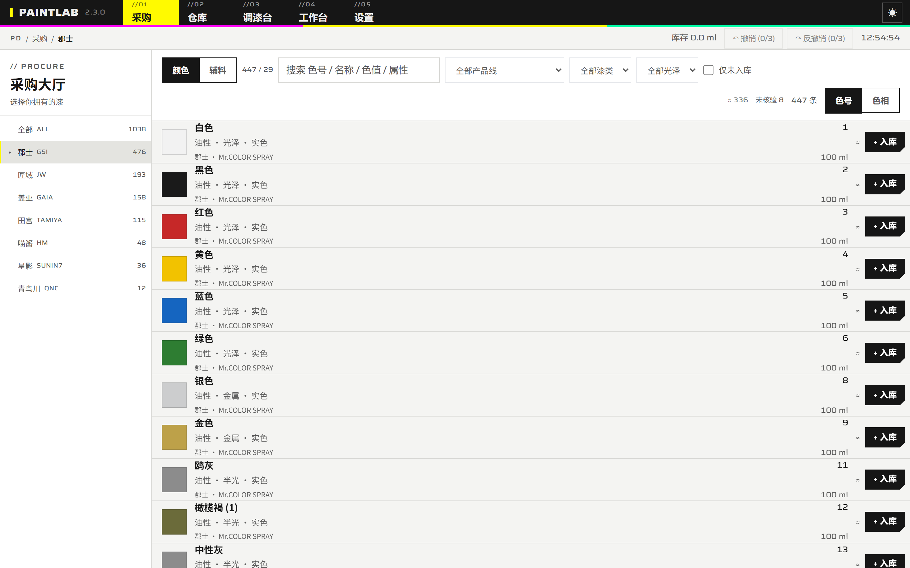
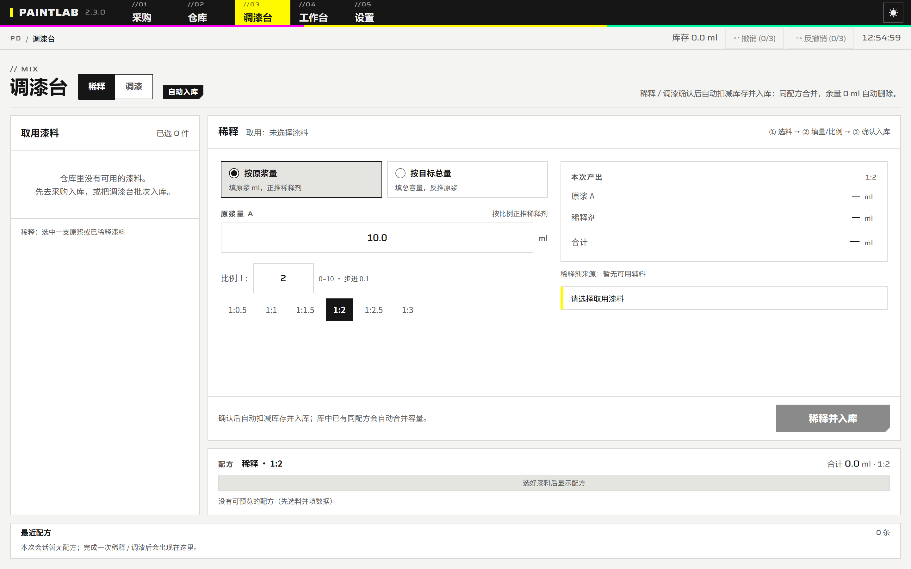
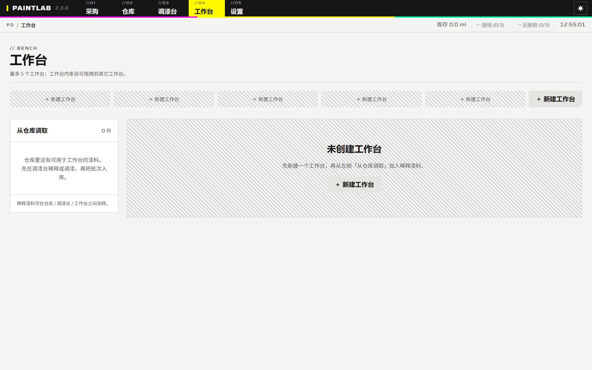
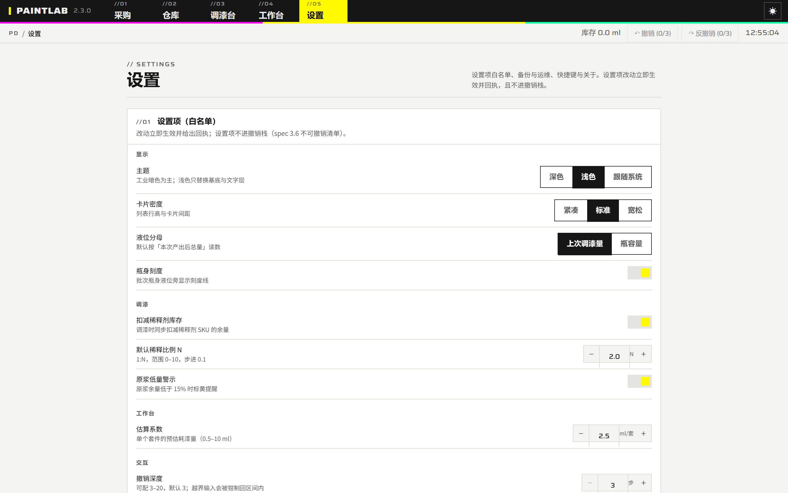
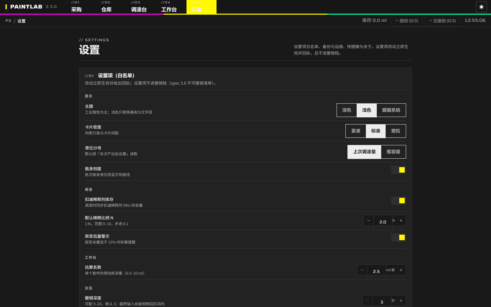
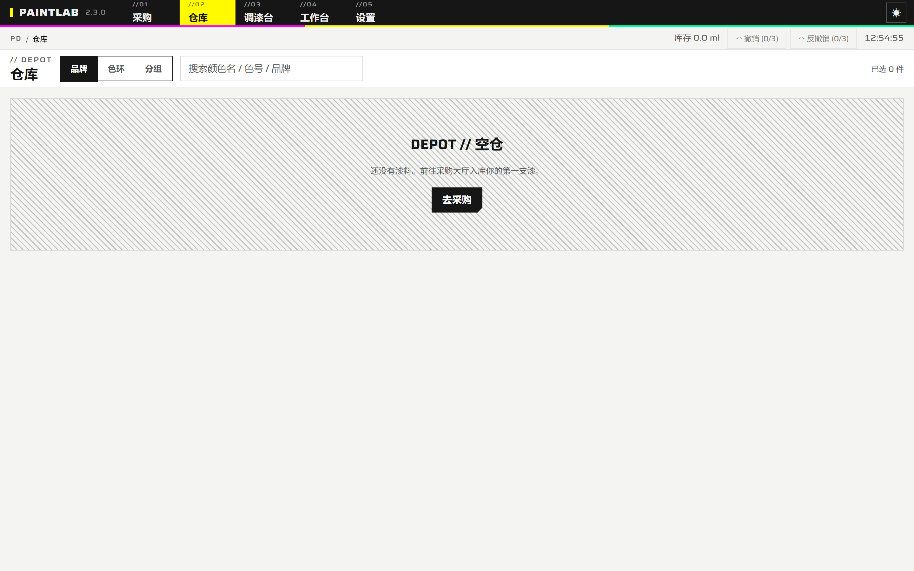

# PAINTLAB · 漆料资产与调漆工作台

> 面向模型涂装玩家的**漆料资产与调漆工作台**：采购入库 → 仓库管理 → 调漆台（稀释 / 调漆）→ 工作台开涂。
> 本地优先、离线可用，**独立桌面应用**（Electron，固定 origin `app://paintlab`）+ 浏览器版，界面为「终末地风味」纸面工业风。

[](https://github.com/Anserss/paintlab/releases)
[](LICENSE)
[](#下载与安装)
[](IMPLEMENTATION.md)
[](docs/seed/README.md)

**English** — PAINTLAB is a local-first workshop for scale-model paint collectors: track bottles, thin and mix paints from 7
brands (1,038 catalog entries), and keep every operation undoable. Windows desktop app (Electron) plus a browser build.
All user data stays on your machine; the downloadable package contains **no user data**.



---

## 目录

- [功能](#功能)
- [下载与安装](#下载与安装)
- [截图](#截图)
- [开发](#开发)
- [测试与验收](#测试与验收)
- [数据与许可](#数据与许可)
- [文档](#文档)
- [已知问题](#已知问题)
- [版本号规则](#版本号规则)

---

## 功能

| 页面 | 能力 |
|---|---|
| **采购** `/procure` | 7 品牌 1,038 条目录；颜色 / 辅料两个货架；按品牌、产品线、漆类、光泽筛选；色号 / 色相两种列表；入库时可选原浆 / 稀释并填容量 |
| **仓库** `/depot` | 库存条目、分组树（≤ 3 层）、盘点、移动、详情抽屉、改名、删除（可直接删，也可「分解回原浆 / 辅料」）、多选开涂 |
| **调漆台** `/mix` | 稀释模式（原浆 + 稀释剂，1:N 0–10）；调漆模式（总量 ÷ 配比 / 各组分用量两种算法）；**确认即自动入库**；同配方自动合并容量；余量 < 20% 或 < 10 ml 弹窗提醒并挂红牌；0 ml 自动删除 |
| **工作台** `/workbench` | 最多 5 个工作台；磁贴 + 用量面板；从仓库调取稀释 / 调漆产物；按 ml/套 估算还能涂多少套 |
| **设置** `/settings` | 设置项白名单（主题 / 密度 / 液位分母 / 刻度 / 稀释比例 / 撤销深度 …）；数据运维（全量导出、库存 CSV、导入、重置）；快捷键；关于 |

**贯穿全站的四个动词**：任何进仓库叫**入库**，任何进调漆台叫**调漆**，任何进工作台叫**开涂**，调漆台内的产出叫**稀释 / 调漆**。

- **一个事务 + 一个 Command**：所有写操作整体成功或整体不生效，可撤销（`Ctrl/⌘ + Z`）。
- **目录只读**：品牌、色号、色值、规格随版本发布；目录外颜色走 `custom` 自定义命名空间，不覆盖 catalog。
- **动效（2.3.0）**：短、硬、机械，每个动效对应一次操作或状态变化；入场 ≤ 1s、不循环；系统「减少动态效果」时全部关闭。
- **深色 / 浅色**：两套完整主题，切换时从按钮处圆形揭幕。

## 下载与安装

**下载**：到 [Releases](https://github.com/Anserss/paintlab/releases) 下载 `PAINTLAB-2.3.0-win64.zip`（Windows 10/11 x64，免安装）。

```text
PAINTLAB-2.3.0-win64.zip
└─ PAINTLAB-2.3.0-win64/
   ├─ PAINTLAB.exe          双击启动
   ├─ resources/app/        Electron 应用（main / preload / dist）
   ├─ docs/                 随包说明文档（含「数据范围与字段级权限」）
   ├─ README.md, LICENSE, version.txt
   └─ …                     Electron 运行时
```

- **免安装**：解压到任意目录，双击 `PAINTLAB.exe`。删掉文件夹即卸载。
- **数据位置**：`%APPDATA%\PAINTLAB`（IndexedDB，固定 origin `app://paintlab`，升级换版本不换库）。
- **包里没有你的数据**：发布包只含程序与目录数据（品牌 / 色号 / 色值），**不含任何库存、分组、工作台、用量记录或设置**。首次启动是一份空仓库。
- **从源码安装到本机**（开发用）：`npm run desktop` → 安装到 `%LOCALAPPDATA%\Programs\PAINTLAB` 并建快捷方式。

> 首次启动如果 Windows SmartScreen 提示「未知发布者」，是因为安装包未做代码签名：点「更多信息 → 仍要运行」即可。

## 截图

| 采购大厅 | 调漆台 |
|---|---|
|  |  |

| 工作台 | 设置（2.3.0 起不再有「数据范围」面板） |
|---|---|
|  |  |

| 设置（深色） | 仓库（空库首次启动） |
|---|---|
|  |  |

截图来自空库的干净实例（没有加载任何个人数据）。

## 开发

要求：Node.js ≥ 18（实测 Node 24）、Windows 10/11（桌面壳）；浏览器版跨平台。

```bash
npm install --ignore-scripts   # Electron 运行时按脚本缓存，先跳过 postinstall
npm run dev                    # http://localhost:5175（浏览器版，热更新）
npm run build                  # PWA 构建
npm run build:desktop          # 桌面构建（关闭 Service Worker）
npm run desktop                # 构建 + 安装到 %LOCALAPPDATA%\Programs\PAINTLAB + 快捷方式
npm run typecheck              # tsc --noEmit
npm test                       # vitest run：38 文件 / 423 用例
npm run verify:motion          # 动效验收（另开 npm run dev）：Playwright 真实浏览器 24 项
```

技术栈：Vite 5 + React 18 + TypeScript 5.6(strict) + Tailwind 3.4 + Zustand 4 + Dexie 4（IndexedDB）+ Zod 3，
桌面壳 Electron（`desktop/electron`，固定 origin `app://paintlab`）。

```text
desktop/electron/    桌面壳（main / preload / package.json）
scripts/             make-desktop / make-launcher / 目录管线 / verify-motion
src/app/             Shell / CommandBar / StatusBar / 路由 / 动效编排
src/core/            领域层（types / schemas / math：dilution + blend / rules / history）
src/data/            db（Dexie v2）/ repos / catalog
src/store/           切片 + hydrateApp
src/components/      ui / paint / bottle
src/features/        procure / depot / mix / workbench / settings
src/styles/          tokens / base / texture / motion
tests/unit/          app · core · data · components · features
docs/                规格 / 各版本改版说明 / 随包说明文档 / 截图
```

## 测试与验收

| 命令 | 期望 |
|---|---|
| `npx tsc --noEmit` | 0 错 |
| `npx vitest run` | 38 文件 / 423 用例通过 |
| `npm run build:desktop` | 成功（2.3.0：CSS 38.81 kB / JS 659.27 kB，gzip 207.86 kB） |
| `npm run verify:motion` | 24 / 24（需先 `npm run dev`） |

## 数据与许可

| 品牌 | 产品线 | 条数 |
|---|---|---|
| 郡士 GSI Creos（`gsi`） | 25 条系列（Mr.COLOR / GX / GGX / 水补土 / 稀释剂…） | 476 |
| 匠域 Jumpwind（`jy`） | 12 条系列（NEO / MEKA / AQUEOUS / CT 稀释剂 / MP 底液…） | 193 |
| 盖亚 Gaianotes（`gaia`） | 6 条系列 | 158 |
| 田宫 Tamiya（`tamiya`） | 4 条系列 | 115 |
| 喵酱 Hobby Mio（`hobbymio`） | 2 条系列 | 48 |
| 星影 Sunin7（`sunin7`） | 3 条系列 | 36 |
| 青鸟川 QNC（`qnc`） | 2 条系列 | 12 |
| **合计** | 54 条 | **1038** |

- 主数据源为 [afzafri/modkit-swatch](https://github.com/afzafri/modkit-swatch)（MIT），另按厂商官方产品页手补辅料；原文许可见 [`docs/seed/README.md`](docs/seed/README.md)。
- 色值：644 条已核验；872 条为推定 / 社区色值（`hexEstimated: true`），界面用行内 `≈` 与工具栏摘要标注，**不谎报官方色值**。
- 代码 MIT（见 [LICENSE](LICENSE)）。本项目为个人非官方工具，与任何漆料厂商无隶属关系；不使用、不打包任何厂商 Logo 或《明日方舟》素材。
- 界面字体 Saira（SIL OFL 1.1），随包放在 `public/fonts/`。

## 文档

| 文档 | 内容 |
|---|---|
| [`docs/数据范围与字段级权限.md`](docs/数据范围与字段级权限.md) | 数据分区 / 字段级写入权限 / 配额（2.3.0 起从设置页迁出，随包发布） |
| [`docs/PAINTLAB-2.3.0-改版说明.md`](docs/PAINTLAB-2.3.0-改版说明.md) | 动效清单与验收 |
| [`docs/PAINTLAB-2.2.2-改版说明.md`](docs/PAINTLAB-2.2.2-改版说明.md) | 目录扩到 7 品牌 1038 条、货架重排 |
| [`docs/PAINTLAB-2.0-桌面化与视觉重做规格.md`](docs/PAINTLAB-2.0-桌面化与视觉重做规格.md) | 视觉与交互规格（111 KB） |
| [`docs/漆料管理软件-项目设计描述书.md`](docs/漆料管理软件-项目设计描述书.md) | 项目设计描述书（§3.7 数据边界 / AC-12） |
| [`IMPLEMENTATION.md`](IMPLEMENTATION.md) | 分层、脚本、数据流与验收命令 |
| [`CHANGELOG.md`](CHANGELOG.md) | 版本变更记录 |
| [`docs/README.md`](docs/README.md) | 文档索引 |

## 已知问题

1. 872 条色值为推定 / 社区色值（`≈` 标注），未按实物色卡核验。
2. 新增 5 个品牌没有中文漆名（沿用上游日文 / 英文名），中文检索只能命中色号与类目。
3. 田宫 `X-20A` / `X-20`、星影 `TH-01` 系列、青鸟川稀释液仍标「待核验」；匠域 7 条珍珠色（GC004–GC010）名称待补。
4. 自动快照未实现（设置页提供导出替代）。
5. 安装版窗口在 150% 缩放下右侧被裁（旧问题，非 2.3.0 引入）；非最大化 1280×800 可绕开。
6. 浏览器窄屏（< 1120）仍是桌面布局：390 宽没有文档横向滚动，但左栏与工具栏会裁切。
7. 换页 / 深浅切换的 View Transition 需要 Chromium 111+；Firefox 直接切换、不补动画。
8. 打包单 chunk 约 659 KB（gzip 208 KB），未做 manualChunks 拆分。

## 版本号规则

> **未经维护者明确指示，不修改版本号**（`package.json` 的 `version` 与 `src/platform.ts` 兜底值）；
> 发版需同步 `README.md` / `IMPLEMENTATION.md` / `CHANGELOG.md` 与 `docs/` 版本说明。
