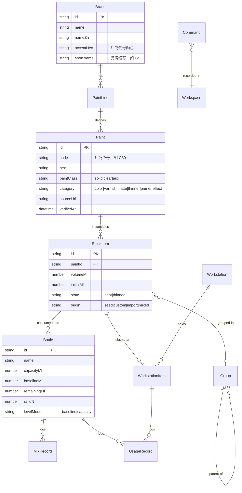
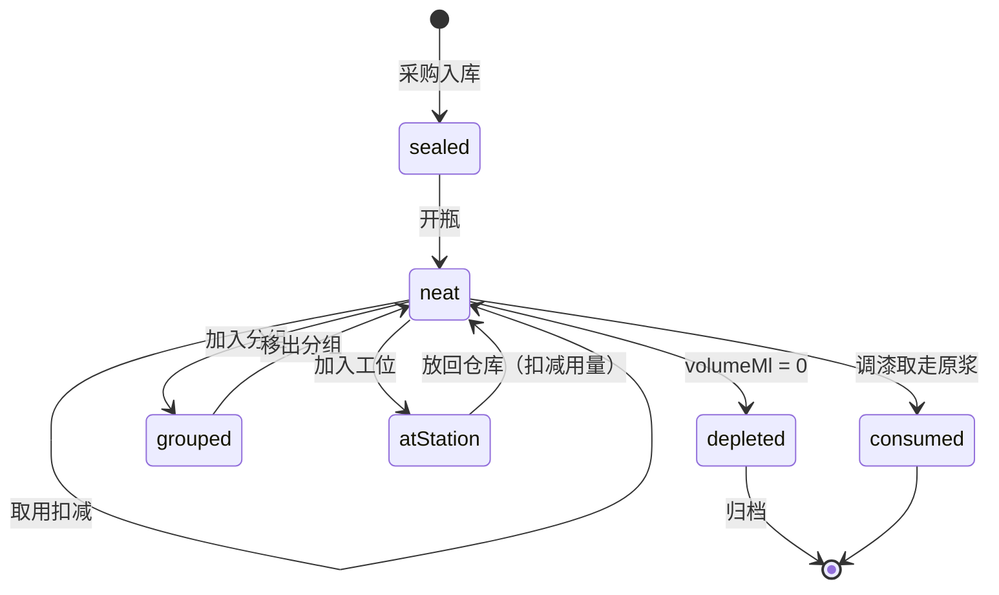
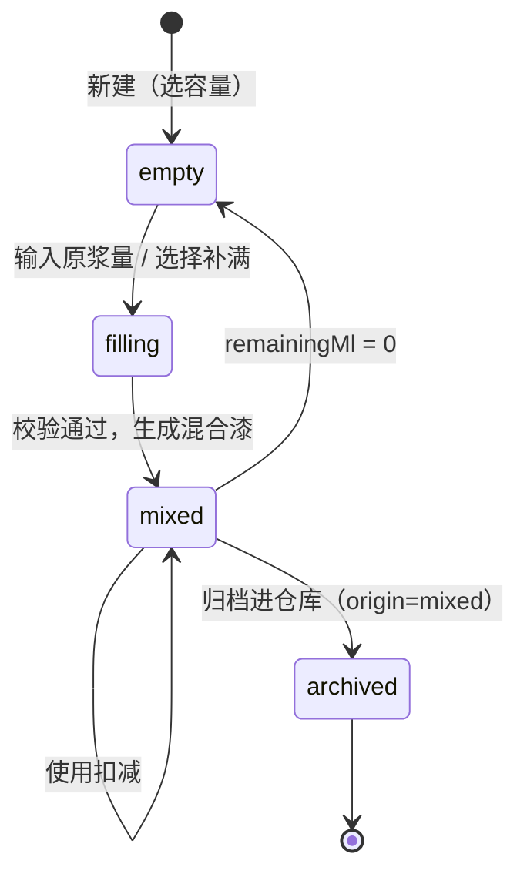
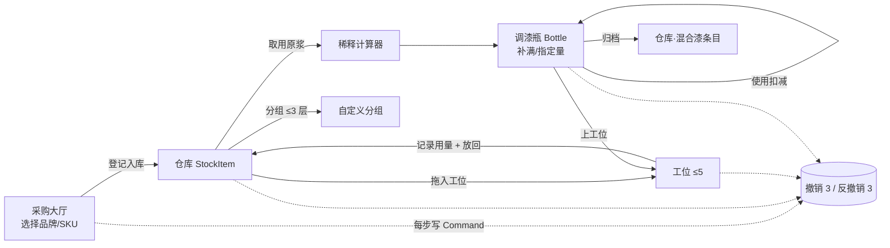

# 漆料管理软件 · 项目设计描述书

> **代号**：`PIGMENT-DEPOT`（颜料仓库）
> **文档版本**：v1.3（核验/构建脚本已实现并跑通 256 条数据）
> **文档性质**：实施级设计说明，可直接据此排期、拆任务、验收
> **目标读者**：产品 / 前端 / 视觉 / 测试 / 单人全栈开发者
> **参考项目**：HalleyLab / Rhine Lab（`https://github.com/HalleyLab/Rhine_Lab`）
> **参考色库**：GK-Mixer（`https://gk-colormixer.com.hdinever.top/`）——仅参考其品牌/系列/色号的数据组织方式，不复用其界面与代码
> **视觉基调**：明日方舟式实用主义工业美学 × 包豪斯构成主义

**v1.1 已确认决策（原 10.5 待确认项）**

| 项 | 结论 |
|---|---|
| Q5 首批品牌 | **郡士（油性）/ 匠域 / 田宫（油性）/ AK（油性）** 四个品牌，只做油性（溶剂型）产品线 |
| Q7 品牌标识 | **取消厂商图标**，改为"品牌列表"式导航；色卡以「色块 + 颜色名称 + 厂商色号」呈现，下方一行中文描述「油性/水性 · 光泽度」 |
| Q1 液位分母 | 默认 `baseline`（上次调配后总量），保留 `capacity` 开关 |
| Q2 稀释剂 | 默认计入库存并扣减 |
| Q3 零用量归还 | 允许，但需二次确认 |
| Q4 调漆瓶归档 | 允许，以 `origin='mixed'` 存入仓库 |
| Q6 浅色主题 | 首版只做深色，浅色 P1 |

---

## 0. 阅读指南

| 章节 | 内容 | 谁会读 |
|---|---|---|
| 1 | 产品定义、范围、与参考项目的关系 | 全部 |
| 2 | 领域模型、三档透明度显示规则、状态机 | 开发 / 测试 |
| 3 | 四大模块的功能规格与交互细则 | 产品 / 开发 |
| 4 | 视觉设计系统（令牌、字体、组件、线框） | 视觉 / 前端 |
| 5 | 技术架构、目录结构、核心算法代码 | 开发 |
| 6 | 数据契约：TypeScript 类型、厂商目录种子、导入格式 | 开发 |
| 7 | 验收用例（含数值断言）、测试清单、DoD | 测试 / 开发 |
| 8 | 里程碑与任务拆分 | 项目管理 |
| 9 | 风险与对策 | 全部 |
| 10 | 附录：快捷键、文案、令牌 JSON、流程图源 | 全部 |

**约定**：文中 `P0` = 首版必须交付；`P1` = 首个迭代内补齐；`P2` = 明确不做或留接口。所有容量单位统一为 **毫升 ml**，保留 1 位小数存储、整数显示可选。

---

## 1. 产品定义

### 1.1 一句话定位

一个**本地优先**、面向模型涂装玩家的漆料资产与调漆工作台：把「买过哪些漆、还剩多少、怎么调、调好的放在哪个工位」这件事，浓缩成一块看得懂的仪表盘。

### 1.2 用户与场景

**主用户画像：模型涂装玩家（含新手与进阶）**

- 手上有 30–300 瓶漆，跨 3–8 个品牌，滴瓶、塑料罐、玻璃瓶混杂。
- 真正的工作流是：**选色 → 取原浆 → 按比例稀释 → 装进调漆瓶 → 上工位使用 → 剩回去**。
- 痛点不是"记笔记"，而是"**打开一瓶漆时不知道还剩多少，也不知道上次调的那瓶稀释漆是什么比例**"。

**核心场景（User Journey）**

| # | 场景 | 系统支撑 |
|---|---|---|
| S1 | 刚买了一批漆，想把它们录进来 | 采购大厅模拟采购 → 入库 |
| S2 | 想找"接近某个色的所有漆" | 仓库色环 / 色板矩阵视图 |
| S3 | 想把常用漆归到"德军灰系"分组 | 自定义分组（最多 3 层） |
| S4 | 要喷 1:2 稀释，但不知道加多少稀释剂 | 稀释计算器 + 自动补满算法 |
| S5 | 调好后想知道瓶里还剩几成 | 调漆瓶液位 + 比例读数 |
| S6 | 同时做 3 个套件，各有各的工位 | 工位 ≤ 5，自定义命名 |
| S7 | 手滑把漆加错工位了 | 撤销 3 次 / 反撤销 3 次 |

### 1.3 产品原则（同时是视觉原则）

1. **信息密度优先于留白**：一屏要能看完 24 瓶漆的关键信息。
2. **一切用形状与刻度表达，不用自然语言解释**：剩多少 = 液位高度，不是一段文字。
3. **每个数值都可追溯**：任何剩余量都能点开看"哪次操作扣的"。
4. **颜色是数据，不是装饰**：色块的透明度本身携带分类语义（见 2.3）。
5. **离线可用**：断网状态下除"采购大厅拉取新品牌包"外全部功能可用。

### 1.4 与 Rhine Lab 的关系（借鉴 / 不借鉴）

| 维度 | Rhine Lab 做法 | 本项目决策 |
|---|---|---|
| 数据形态 | 本地工作区 + 客户端加密快照 + 可选云同步 | **借鉴**：IndexedDB 本地优先，导出/导入加密 JSON 为第一优先级；云同步为 P2 |
| 拖拽 | 支持生物条目等条目化拖拽 | **借鉴并扩展**：拖拽是本项目的主交互（目录→仓库→工位→调漆台） |
| 计算工具 | 科学计算器、配液计算、Master Mix | **借鉴思路**：稀释计算器做成独立的"工具面板"，可被拖拽调用 |
| 库存 | 试剂/耗材、消耗记录、低库存提醒 | **借鉴并改造**：库存单位从"瓶数"改为"毫升"，这是本项目与原项目最大的分野 |
| 多工作区 | 多个 LAB 工作区 + 只读共用 | **裁剪**：简化为"工位 ≤ 5"，不做多用户权限 |
| 视觉 | 莱茵生命技术风（斜切角、编号、技术标签） | **借鉴骨架，换成明日方舟 + 包豪斯配色**：保留编号/斜切/技术标签，主色改为工业橙 + 包豪斯三原色 |
| 技术栈 | 原生 HTML/CSS/JS 多端 + Capacitor + Electron | **不沿用**：改用 React + TS + Vite，理由见 5.1（类型安全对库存扣减至关重要） |

> **法律提示**：Rhine Lab 是《明日方舟》同人风格项目。本项目只借鉴**通用工业 UI 语汇**（斜切角、编号、警示条、等宽数字），不使用任何原作素材、Logo、角色或专有名词；品牌漆料的商标仅用于标识商品本身，需在"关于"页声明非官方、无隶属关系。详见 9.4。

### 1.5 范围

**In Scope（P0）**

- 模拟采购（从厂商目录选漆入库）
- 仓库三视图（品牌 / 色环 / 自定义分组，分组 ≤ 3 层）
- 三档透明度色块渲染规则
- 稀释计算器（正算 / 反算 / 自动补满）
- 调漆瓶可视化（SVG，可配置容量，液位按比例显示）
- 工位（≤ 5 个，自定义名称，多选加入 / 移出 / 记录用量 / 放回仓库）
- 全局撤销 3 次 / 反撤销 3 次
- 用户可写数据范围（字段级权限 + 配额 + 校验）
- 数据导入 / 导出 / 重置

**Out of Scope（明确不做）**

- 真实电商下单、价格与库存联动（P2，仅保留接口）
- 联机协作、账号体系、云端权限
- 喷笔/气泵设备管理、喷涂参数库（P2 可加"备注"字段兜底）
- 自动从官网抓取色卡（仅提供导入模板与手动核验流程，理由见 9.1）
- 移动端原生 App（首版为响应式 Web / PWA，可后续 Tauri 打包）

---

## 2. 领域模型

### 2.1 术语表

| 术语 | 英文键 | 定义 | 关键约束 |
|---|---|---|---|
| 品牌 | `Brand` | 漆料厂商，如 郡士、田宫 | 只读（目录提供） |
| 产品线 | `PaintLine` | 品牌下的系列，如 Model Color、XF 系列 | 只读；携带默认瓶容量 |
| 漆料 SKU | `Paint` | 一支具体颜色的产品，`品牌 + 代号 + 名称 + 色值` | 目录只读；用户自定义 SKU 除外 |
| 色值 | `hex` | 该漆料用于渲染的十六进制颜色 | 只读；自定义漆料可写 |
| 漆类 | `paintClass` | `solid` 实色 / `clear` 透明色 / `aux` 辅助 | 决定透明度规则 |
| 库存条目 | `StockItem` | 仓库里的一"份"漆（同 SKU 可多份） | 单位 ml，`volumeMl ≥ 0` |
| 原浆 | `neat` | 未经稀释的漆 | `state = neat` |
| 稀释漆 | `thinned` | 已按比例加稀释剂 | 必须携带 `ratioN` 与来源配方 |
| 调漆瓶 | `Bottle` | 虚拟容器，容量可配置，内含混合漆 | `remainingMl ≤ capacityMl` |
| 基准量 | `baselineMl` | **上次调配完成瞬间**瓶内总量 | 液位分母（见 3.4.4） |
| 分组 | `Group` | 用户自定义目录节点 | `depth ∈ 1..3`，单归属 |
| 工位 | `Workstation` | 最多 5 个的自定义工作区 | 名称 1–16 字 |
| 稀释比例 | `ratioN` | `1 : N`（原浆 : 稀释剂） | `N ∈ [0, 10]`，步进 0.1 |
| 命令 | `Command` | 一次可撤销动作，含正/反补丁 | 历史栈深 3 |

### 2.2 实体关系



### 2.3 显示规则（核心，全站唯一权威）

所有色块——目录卡、仓库卡、工位卡、调漆瓶液体、分组标题色条——**必须**走同一个渲染函数 `swatch(paint)`，禁止在各组件内硬编码颜色。

| `paintClass` | 判定依据（目录数据） | 渲染规则 | 视觉结果 |
|---|---|---|---|
| `solid` 实色 | 不透明颜料，如模型漆绝大多数色号 | 该漆 `hex`，`alpha = 1.00`（**0% 透明度**） | 饱满实色块 |
| `clear` 透明色 | 名称/代号含 Clear、透明、Tone、Wash、Ink、Glaze、Speedpaint、Contrast 等；或目录显式标注 | 该漆 `hex`，`alpha = 0.40`（**40% 透明度**） | 半透，可透出底板网点 |
| `aux` 辅助料 | 光油、消光、稀释剂、缓干剂、补土、底漆、遮盖液等（`category ≠ color`） | `#FFFFFF`，`alpha = 0.70`（**70% 透明度的白**） | 乳白半透，无色彩语义 |

**渲染约束**

1. 半透明色块**必须**置于统一底板之上，底板为 `--surface-swatch`（见 4.2）+ 8px 网点，否则透明效果不可读。
2. 色块周圈固定 1px `rgba(255,255,255,.16)` 描边，避免深色块与深底融边、白色块与浅底融边。
3. 对比度：色块上的文字（代号/名称）不直接压在色块上，而是放在色块下方的独立信息行，避免动态色值导致文字不可读。
4. 色块最小尺寸 24×24，低于此尺寸（如树节点小圆点）改用 `border-color` 实心圆点 + 白描边，不使用半透明。

```ts
// 唯一实现：packages/core/src/render/swatch.ts
export type PaintClass = 'solid' | 'clear' | 'aux';

export function swatchStyle(hex: string, cls: PaintClass) {
  switch (cls) {
    case 'solid': return { background: hex, opacity: 1 };        // 0% 透明
    case 'clear': return { background: hex, opacity: 0.4 };      // 40% 透明
    case 'aux':   return { background: '#FFFFFF', opacity: 0.7 };// 70% 白
  }
}
```

> 注意：`opacity` 用 CSS `opacity` 而非把 alpha 混进色值——这样网点底板能透出来，且同一函数可复用为 SVG `<g opacity>` 与 Canvas `globalAlpha`。

### 2.3.1 色卡显示规范（Q7 定稿：列表化，不用厂商图标）

**全站不再使用厂商 Logo 图片**，品牌以文字标识；每一条漆料无论出现在采购、仓库、工位还是调漆瓶，都按同一套「三段式」呈现：

```
┌────┬──────────────────────────────────────────────┐
│    │ 钴蓝 Cobalt Blue          C80              │  ← 第 1 行：颜色名称（中/英）+ 厂商色号（等宽）
│ 色 │ 油性 · 光泽 · 实色                            │  ← 第 2 行：中文属性描述（必须中文，逗号分隔）
│ 块 │ 郡士 Mr.Color · 12.4/17.0 ml                  │  ← 第 3 行：品牌 · 系列 · 剩余量（仅库存场景）
└────┴──────────────────────────────────────────────┘
```

| 位置 | 内容 | 数据来源 | 规则 |
|---|---|---|---|
| ① 色块 | 36×36（列表）/ 全宽（磁贴），按 2.3 三档透明度 | `Paint.hex` + `paintClass` | 必须带 1px 白描边与网点底板 |
| ② 颜色名称 | 中文优先，英文次要（同行右侧或次行小字） | `Paint.nameZh` / `Paint.name` | 无中文名时只显示英文，不占位 |
| ③ 厂商色号 | 等宽字体、`tabular-nums`，2 倍字重感 | `Paint.code` | 无编号品牌（如需）显示产品线简称；缺省显示 `—` |
| ④ **属性描述（中文）** | `油性 · 光泽 · 实色` | `PaintLine.solvent` + `Paint.finish` + `Paint.paintClass` | **强制中文**；顺序固定：油水性 → 光泽度 → 漆类；`·` 分隔 |
| ⑤ 来源行 | 品牌 · 产品线 · 余量/规格 | `Brand.nameZh` + `PaintLine.name` | 库存场景必显示余量，目录场景显示规格 |

**属性词表（枚举 → 中文）**

| 字段 | 枚举 | 中文输出 |
|---|---|---|
| `solvent` | `oil` / `water` / `na` | **油性** / **水性** / 免稀释（预调类） |
| `finish` | `gloss` / `semiGloss` / `matte` / `metal` / `pearl` | **光泽** / **半光** / **消光** / **金属** / **珠光** |
| `paintClass` | `solid` / `clear` / `aux` | **实色** / **透明** / **辅助** |

> 词表为唯一真相：任何界面不得自造同义词（"亮光/哑光/平光"等一律映射到上述五档）。`finish` **不参与**透明度计算——透明度只由 `paintClass` 决定（2.3），二者不得混淆。

```ts
// core/render/label.ts —— 第 2 行描述的唯一拼接处
const SOLVENT_ZH = { oil: '油性', water: '水性', na: '免稀释' } as const;
const FINISH_ZH  = { gloss: '光泽', semiGloss: '半光', matte: '消光', metal: '金属', pearl: '珠光' } as const;
const CLASS_ZH   = { solid: '实色', clear: '透明', aux: '辅助' } as const;

export function paintDescription(p: Paint, line: PaintLine): string {
  return [SOLVENT_ZH[line.solvent], FINISH_ZH[p.finish], CLASS_ZH[p.paintClass]].join(' · ');
}
```

**兼容规则**：`aux` 类（稀释剂、消光油等）仍显示 `油性 · — · 辅助`，其中 gloss 位用 `—` 占位，不显示"光泽"。


### 2.4 状态机

**A. 库存条目 `StockItem`**



**B. 调漆瓶 `Bottle`**



**C. 关键不变量（Invariants，必须写进校验层）**

| ID | 不变量 | 违反时 |
|---|---|---|
| I1 | `0 ≤ StockItem.volumeMl ≤ initialMl` | 拒绝操作 + Toast |
| I2 | `0 ≤ Bottle.remainingMl ≤ Bottle.baselineMl ≤ Bottle.capacityMl` | 拒绝调配 |
| I3 | `Group.depth ≤ 3`，且 `child.depth = parent.depth + 1` | 禁止新建/拖入 |
| I4 | `workstations.length ≤ 5` | 禁用"新建工位"按钮并说明 |
| I5 | 每条 `StockItem` 最多归属 1 个 `Group` | 拖入即移动，不复制 |
| I6 | 稀释比例 `0 ≤ ratioN ≤ 10` | 输入框钳制 |
| I7 | 任何扣减操作必须原子写入 `UsageRecord` | 事务内校验 |
| I8 | 历史栈 `undo.length ≤ 3`、`redo.length ≤ 3` | 超出即丢弃最旧 |

---

## 3. 功能规格

### 3.1 信息架构与导航

**一级导航共 5 项**（左侧竖向工具条，宽度 72px，图标 + 竖排 2 字标签 + 序号）：

```
//01 采购   //02 仓库   //03 调漆   //04 工位   //05 设置
```

**页面路由表**

| 路由 | 页面 | 核心区域 | 快捷键 |
|---|---|---|---|
| `/procure` | 采购大厅 | 左侧品牌列表 + 右侧色号列表 + 批量登记条 | `1` |
| `/depot` | 仓库 | 视图切换（品牌/色环/分组）+ 左侧树 + 中间网格 + 右侧详情抽屉 | `2` |
| `/mix` | 调漆台 | 左侧原浆取用 + 中间调漆瓶 + 右侧计算器/历史 | `3` |
| `/station` | 工位 | 顶部工位 Tab（≤5）+ 工位内容网格 + 用量面板 | `4` |
| `/settings` | 设置 | 数据范围 / 数据 / 主题 / 关于 | `5` |

**全局常驻区**

- 顶部状态栏（高 44px）：面包屑 `仓库 / 品牌 / 郡士 / Mr.Color`、库存总量徽标、撤销/反撤销按钮组、时钟（`HH:MM:SS` 等宽）。
- 右下角"操作回执"栈（Toast，最多 3 条，含"撤销"快捷入口）。

### 3.2 采购大厅（模拟采购）· P0

**定位**：不是电商，是"**选择你拥有哪些漆**"的登记入口。强调"登记/入库"语义，弱化价格。

**布局（Q7 定稿：品牌列表式，无厂商图标）**

```
┌ 品牌列表 216px ──┬── 色号列表（主区）──────────────────────────┐
│ 全部        128   │ [搜索 色号/名称/色值]  [系列▾] [属性▾] 仅未入库 │
│ ───────────────   │ ───────────────────────────────────────── │
│ ▎郡士 GSI     42  │  ■  钴蓝 Cobalt Blue            C80    │
│   油性 · 4 系列    │     油性 · 光泽 · 实色                     │
│ 匠域 JY      28  │     郡士 Mr.Color · 10 ml      [ + 登记 ]  │
│ 田宫 Tamiya   31   │ ───────────────────────────────────────── │
│ AK           27   │  ■  亮光红                        JW005   │
│                   │     油性 · 光泽 · 实色                     │
│                   │     匠域 JW · 10 ml            [ + 登记 ]  │
└───────────────────┴──────────────────────────────────────────┘
```

- **左栏 = 品牌列表**（纯文字，不使用任何 Logo 图片）：品牌中文名 + 英文缩写 + 目录件数；选中态为左侧 2px 主色竖条 + `--surface-2` 底。品牌下可展开产品线二级列表（如「郡士 → Mr.Color / Mr.Color GX / Mr.Color 高达色」）。
- **右栏 = 色号列表**（`PaintRow`，见 4.5.1）：每行三段式——色块 / 颜色名 + 厂商色号 / 中文属性行（`油性 · 光泽 · 实色`）。默认按色号升序，可切"按色相"。
- **筛选**：品牌、产品线、漆类（实色/透明/辅助）、光泽度（光泽/半光/消光/金属）、是否已入库。
- **搜索**：色号 `C80` / `XF-1` / `RC316`、中英文名、色值 `#RRGGBB`、属性词 `油性` `消光`。
- **底部批量条**：`登记入库 (n)` / `加入分组` / `清空选择`。

**列表行状态**

| 状态 | 表现 |
|---|---|
| 未入库 | 常规行，行尾 `+ 登记` 按钮 |
| 已入库 | 行首加 `已登记 ×2` 徽标，按钮变 `再登记一份` |
| 规格待核验 | 规格处显示 `⚠ 待核验`，悬停提示"该规格尚未核验，按默认 10 ml 记账" |
| 停产/限定 | 整行 `opacity:.55` + 左侧 45° 细斜纹 |

**登记入库流程**

1. 选择容量（默认取 `PaintLine.defaultVolumeMl`，可改；用户可选"整瓶 / 半瓶 / 自定义 ml"）。
2. 选择初始状态：`原浆`（默认）/ `稀释`（需填比例 N）。
3. 写入 `StockItem`，生成 `Ledger` 记录与一个可撤销 `Command`。
4. 回执：「已登记 郡士 C80 钴蓝 10 ml」 + 撤销。

**性能要求**：目录按品牌懒加载品牌包（`/data/catalog/{brandId}.json`），首屏只加载品牌索引；单品牌 > 200 SKU 时列表虚拟化。

### 3.3 仓库 · P0

**三视图（顶部 Segmented Control）**

| 视图 | 结构 | 适用 |
|---|---|---|
| **品牌**（默认） | 左树：品牌列表（纯文字）→ 产品线 → 漆类；右侧**行式色卡列表**，按品牌/系列分组显示 | 找"我买的那支" |
| **色环** | 极坐标色环（12 个 30° 色相扇区）+ 下方色板矩阵（色相 12 列 × 明度 5 行） | 找"我要的色" |
| **分组** | 左树：用户自定义分组（≤3 层）；右侧行式列表 | 找"我归的类" |

**色环视图细节**

- 扇区按 `HSL.h` 分 12 档（每 30°），半径方向按 `S`（内低外高）或固定半径仅以角度分相。
- 无彩色（S < 8%）与 `clear` / `aux` 单列独立"灰/黑/白"与"辅助"两个扇区，放在环心与环外。
- 点击扇区 → 过滤右侧网格；再次点击取消。环上每个扇区显示件数徽标。
- 色板矩阵是**默认可读视图**（环是入口，矩阵是清单）：行 = `L` 五档（`0–20/20–40/40–60/60–80/80–100`），列 = 色相 12 档，每格内小方块按库存量排序。

**分组视图（≤ 3 层）细节**

- 树节点：`L1 / L2 / L3` 深度徽标 + 名称 + 件数 + 折叠箭头。深度 3 的节点不显示"新建子分组"。
- 拖拽：漆料卡 → 分组节点 = 加入（单归属，自动从旧分组移出）；分组节点 → 分组节点 = 移动子树；拖到根 = 移出分组。
- 校验：拖入 L3 的子级时禁止并提示"分组最多 3 层"。
- 操作：新建 / 重命名（≤ 16 字）/ 删除（子项回到"未分组"，二次确认）/ 排序（手动拖拽排序）。
- 保留系统分组：`未分组`（不可删、不可改名、L1）。

**漆料详情抽屉**

显示：大色块（按 2.3 规则）→ 颜色名（中/英）+ 厂商色号（等宽大字）→ **中文属性行 `油性 · 光泽 · 实色`** → 品牌 + 产品线（纯文字，无图标）→ 色值 `#RRGGBB` → 规格与当前库存 `12.4 / 17.0 ml`（进度条）→ 归属分组 → 最近 10 条操作（采购/调漆取用/工位用量/归还）→ 操作按钮：`加入工位` / `取用调漆` / `调整余量` / `删除条目`。

**"调整余量"（盘点）**：允许直接改写 `volumeMl`（用户可写范围见 3.7），必须填原因（`挥发/洒漏/估读/其他`），写入 `Ledger`，可撤销。

### 3.4 调漆台与稀释计算器 · P0

#### 3.4.1 布局

```
┌───────────────┬──────────────────────────────┬──────────────────┐
│ 取用原浆        │  [色块] 郡士 · C80 钴蓝         │  稀释计算器        │
│ ─ 已选 1 件     │  剩余 40.0 / 60.0 ml  ≈ 2/3(67%) │  原浆 A  [ 16.6 ] │
│ [色块] C80    │         ▄▄▄▄▄▄▄              │  比例 1 : [ 2  ]  │
│  钴蓝 18.0ml   │         ███████  ← 液面       │  稀释剂 33.2 ml   │
│ [色块] 71.037  │         ███████              │  合计   49.8 ml   │
│  ...          │         ███████              │  ───────────────  │
│               │         └───────┘              │  ○ 补满瓶（推荐）  │
│ [+ 从仓库取用] │   [调配] [使用] [清空] [归档]   │  ○ 指定原浆量      │
│               │   瓶容量 [60] ml  基准:上次      │  [ 调配 ]          │
└───────────────┴──────────────────────────────┴──────────────────┘
```

#### 3.4.2 稀释计算器（三种模式）

| 模式 | 已知 | 求 | 公式 |
|---|---|---|---|
| **正算** | 原浆量 `A`、比例 `N` | 稀释剂 `D`、总量 `V` | `D = A × N`；`V = A + D = A(1+N)` |
| **反算** | 目标总量 `V`、比例 `N` | 原浆 `A`、稀释剂 `D` | `A = V / (1+N)`；`D = V - A` |
| **补满**（本项目主推） | 瓶容量 `C`、当前余量 `R`、比例 `N` | 原浆 `A`、稀释剂 `D` | `S = C - R`（可容纳）；`A = S / (1+N)`；`D = A × N` |

> 施工口径：所有结果 **向下取整到 0.1 ml**（`floor(x*10)/10`），保证不溢出。UI 同时显示"取整前值"供核对。

**验收算例（必须一致）**

| 输入 | 期望输出 |
|---|---|
| `A=10`, `N=2` | `D=20.0`, `V=30.0`（对应用户描述"10 毫升原浆 1:2 得 30 毫升"） |
| `V=30`, `N=2` | `A=10.0`, `D=20.0` |
| `C=60`, `R=10`, `N=2` | `S=50`, `A=16.6`, `D=33.2`, `V=49.8`（+10 → 59.8，`baseline=59.8`，视为"补满"） |
| `A=99`, `N=1`, `C=100`, `R=9` | 溢出 → 拒绝，提示"最大可加原浆 45.5 ml" |

**比例预设**：`1:0.5 / 1:1 / 1:1.5 / 1:2 / 1:2.5 / 1:3 / 自定义`，自定义范围 `0–10`，步进 `0.1`，输入非法时钳制并抖动提示。

**稀释剂来源**：设置项 `trackThinner`（默认开）。开启时稀释剂也是一条 `StockItem`（`paintClass = aux`），调配时扣减；关闭时只记数值不扣库存。

**配方记忆**：每次调配生成 `MixRecord`，可在"最近配方"列表一键复现（带入相同原浆、比例、容量）。

#### 3.4.3 调漆瓶组件（视觉主体）

**结构（自下而上 SVG 图层）**

| 层 | 内容 | 说明 |
|---|---|---|
| L0 | 瓶体轮廓 | 圆角矩形容器 + 瓶颈 + 螺纹 + 瓶盖；外描边 1px |
| L1 | 玻璃内阴影 / 高光 | 左侧竖向高光带 `rgba(255,255,255,.10)`；右侧暗边 |
| L2 | **液体**（`clip-path` 裁切） | 底部矩形，颜色 = 原浆 `hex`，`opacity` 按 2.3 规则；顶部加 6px 渐变模拟弯月面 |
| L3 | 刻度 | 12 等分短横线，每 3 格加长 + 数字（`1/4 1/2 3/4`）|
| L4 | 标签牌 | 品牌代号、名称、色号、剩余量、比例（等宽字，贴齐左边缘）|
| L5 | 状态角标 | `原浆` / `1:2` / `空` / `溢出` 斜切角标（右上） |
| L6 | 交互热区 | 悬停显示液位百分比气泡；点击打开"使用/调配"弹层 |

**瓶容量选择**：预设 `15 / 30 / 60 / 100 ml` + 自定义 `5–250 ml`（整数）。切换容量时若 `remainingMl > 新容量`，禁止并提示"瓶内尚有 80 ml，请先倒出或选择 ≥ 80 ml 的瓶"。

**液体颜色**：单色 → 该漆 `hex`；多组分混色 → 按体积加权 RGB 混合（sRGB 线性混合），`clear` 组分权重减半（透明度感知补偿）。

#### 3.4.4 液位显示规则（本项目最易出错处，单独定义）

**定义两个量**

- `capacityMl` `C`：瓶子物理容量。
- `baselineMl` `L`：**上一次调配完成瞬间**的瓶内总量（"补满"模式下等于 `C`）。
- `remainingMl` `R`：当前剩余。

**默认规则（baseline 模式）**

```
fraction = clamp01(R / L)                       // 用户示例：40 / 60 = 2/3
heightPx = round(fraction * innerHeight)         // 液面高度
quantized = round(fraction * 12) / 12            // 取大概值：1/12 刻度吸附
reading  = "≈ " + 分数(quantized) + "（" + pct + "%）"
```

**用户示例复算（写入验收用例）**

> 上次剩 **10 ml** → 本次新调 **50 ml**（1:2 下即原浆 16.7 + 稀释剂 33.3）→ 共计 **60 ml** → `baseline = 60` → 使用 **20 ml** → `remaining = 40` → 显示 **40 / 60 ≈ 2/3（67%）**。

**物理模式（可切换）**

设置 `levelMode: 'baseline' | 'capacity'`。`capacity` 模式下 `fraction = R / C`，用于"想看到瓶子真实有多满"的用户。两模式在 `L = C`（即每次补满到瓶口）时完全一致——这也是默认工作流的常态。

**边界**

| 情形 | 表现 |
|---|---|
| `R = 0` | 空瓶态：虚线轮廓 + 文字 `空瓶 · 可归档`，液位层隐藏 |
| `R = L` | 满液位，液面贴到瓶颈刻度线，显示 `100%` |
| `R / L < 1/12` | 仍显示最小 1 格（`≈1/12`），并提示"余量不足 1 格，建议清空" |
| 液面动画 | 数值变化时 220ms `spring` 过渡，`prefers-reduced-motion` 下直接跳变 |

#### 3.4.5 调配事务（必须原子）

```ts
function commitMix(bottle, { neatMl, ratioN, sourceStock, thinnerStock, mode }) {
  const total = round1(neatMl * (1 + ratioN));
  const nextRemaining = round1(bottle.remainingMl + total);

  assert(neatMl > 0, '原浆量必须大于 0');
  assert(ratioN >= 0 && ratioN <= 10, '比例超出范围');
  assert(nextRemaining <= bottle.capacityMl, '超出瓶容量');
  assert(sourceStock.volumeMl >= neatMl, '原浆库存不足');
  if (trackThinner) assert(thinnerStock.volumeMl >= neatMl * ratioN, '稀释剂不足');

  return [
    patch(bottle, { remainingMl: nextRemaining, baselineMl: nextRemaining, ratioN }),
    patch(sourceStock, { volumeMl: sourceStock.volumeMl - neatMl }),
    ...(trackThinner ? [patch(thinnerStock, { volumeMl: thinnerStock.volumeMl - neatMl * ratioN })] : []),
    append('MixRecord', { bottleId: bottle.id, neatMl, ratioN, total, at: now() }),
  ];
}
```

**使用（扣减）事务**

```ts
function commitUse(target, amountMl) {
  assert(amountMl > 0);
  assert(amountMl <= target.remainingMl (或 volumeMl), '超出剩余量');
  const next = round1(remaining - amountMl);
  return [
    patch(target, { remainingMl/volumeMl: next }),
    append('UsageRecord', { targetType, targetId, amountMl, at: now() }),
    next === 0 ? emit('empty', target) : noop(),
  ];
}
```

### 3.5 工位 · P0

**规则**

- 最多 **5** 个工位；未创建时显示 5 个虚线占位槽 `+ 新建工位`。
- 名称 1–16 字，可重命名；可选图标色（从 6 个工业色中选）；可加 1 行备注。
- 工位内条目引用 `StockItem` 或 `Bottle`（调漆瓶也可上工位）。
- 删除工位：条目不丢，直接回到仓库（二次确认，可撤销）。

**加入工位（两条路径，都要实现）**

1. **拖拽**：仓库卡 → 工位 Tab 或工位页面空白区。
2. **多选 + 批量**：仓库中 `Ctrl/Shift` 多选 → 底部浮出操作条 `加入工位 ▾` → 选择目标工位。

**工位页面**

- 顶部：工位 Tab（横向，含件数与总毫升数徽标）+ `新建工位`。
- 主区：工位内漆料卡网格（复用 `PaintTile`，追加"计划用量"与"使用量"数字）。
- 右侧：用量面板——为该条目记录**大概使用量**：
  - 滑块 `0–20 ml`（步进 `0.5`）+ 预设按钮 `1 / 2 / 5 / 10 ml` + 数字输入。
  - 文案提示"大概用量即可，用于估算剩余"。默认值 = `min(2, 剩余量)`。
- 底部操作条（多选）：`记录用量` / `放回仓库` / `移出工位`。

**"放回仓库"流程（关键）**

1. 对每个选中条目，取"记录用量"值 `u`（默认 0；为 0 时视为仅移出，不扣减，需提示确认）。
2. 扣减：`StockItem.volumeMl -= u` 或 `Bottle.remainingMl -= u`。
3. 解除工位归属，条目回到仓库（保持所在分组不变）。
4. 仓库中该漆料按 **2.3 显示规则 + 实时余量**重新渲染：色块不变、余量数字与进度条更新、`< 20%` 时加低库存警示斜纹。
5. 若扣减后为 0 → 标记 `depleted`，在仓库中以 40% 灰化 + `空` 角标呈现，可归档。
6. 全部写入一个 **复合 Command**（一次撤销恢复所有条目与用量）。

**工位统计**：顶部显示 `条目 n · 合计 x.x ml · 预计可涂 m 个套件`（`m = floor(totalMl / 2.5)`，系数可在设置里改，属娱乐性估算，需标注"估算"）。

### 3.6 撤销 / 反撤销（3 + 3）· P0

**模型：命令模式 + 数据补丁**

```ts
interface Command {
  id: string;
  type: 'purchase' | 'group' | 'station' | 'mix' | 'use' | 'adjust' | 'archive' | 'batch';
  label: string;          // "加入工位 ×3"
  at: number;
  forward: Patch[];       // 正向补丁（重做时应用）
  inverse: Patch[];       // 反向补丁（撤销时应用）
}

interface HistoryState {
  undo: Command[];        // 最多 3
  redo: Command[];        // 最多 3
}
```

**规则**

| # | 规则 |
|---|---|
| R1 | 执行任何可撤销动作 → `undo.push(cmd)`；若 `undo.length > 3` 丢弃最旧；**清空 `redo`** |
| R2 | 撤销 → 取 `undo.pop()`，应用 `inverse`，`redo.push(cmd)`；`redo.length > 3` 丢弃最旧 |
| R3 | 反撤销 → 取 `redo.pop()`，应用 `forward`，`undo.push(cmd)` |
| R4 | 补丁应用前后做不变量校验（2.4 的 I1–I8）；失败则回滚该次撤销并 Toast「无法撤销：数据已不满足约束」 |
| R5 | 批量操作（多选加入工位 / 批量采购）合并为 **1 个** Command，避免"撤一次只退一瓶" |
| R6 | 历史持久化到 IndexedDB（`commands` 表），刷新页面后仍可撤销最近 3 步 |
| R7 | 撤销/反撤销本身不产生新的 Command（否则会死循环） |
| R8 | `undoDepth` 可配置 3–20，**默认 3**（产品规格要求为 3） |

**可撤销 / 不可撤销清单**

| 可撤销（进历史） | 不可撤销（不进历史） |
|---|---|
| 采购入库、再登记 | 视图切换、筛选、搜索、排序 |
| 加入/移出分组、新建/重命名/删除分组、分组排序 | 展开/折叠、滚动位置、选中态 |
| 加入工位、移出工位、记录用量、放回仓库 | 设置项修改（立即生效并提示） |
| 调配（补满/指定量）、使用扣减、清空瓶、归档瓶 | 数据导入（走确认对话框）、重置 |
| 盘点调整余量、删除库存条目 | 主题切换、语言切换 |

**UI**

- 顶部状态栏按钮：`↶ 撤销 (2/3)` / `↷ 反撤销 (0/3)`，禁用态 40% 透明并带 `title` 说明。
- 快捷键：`Ctrl+Z` / `Ctrl+Shift+Z`（macOS `⌘Z` / `⌘⇧Z`）。
- 撤销后回执：「已撤销：放回仓库 ×2 [反撤销]」。

### 3.7 用户可写入的数据范围（数据边界规格）

本节回答"系统让用户写到什么程度、写到哪一层、写多少"。分三层：**字段级权限**、**配额上限**、**校验规则**。

#### 3.7.1 数据分区

| 分区 | 归属 | 可写性 | 说明 |
|---|---|---|---|
| `catalog` 厂商目录 | 系统（随版本发布） | **只读** | 品牌、系列、SKU、色值、规格；版本化，随更新合并 |
| `user` 用户数据 | 用户 | **可写** | 库存条目、分组、工位、调漆瓶、用量记录、设置 |
| `custom` 自定义漆料 | 用户 | **可写** | 目录里没有的漆，独立命名空间，带 `origin='custom'` |
| `derived` 派生数据 | 系统计算 | **不可直接写** | 液位、比例读数、库存总计、低库存状态、色环坐标 |

#### 3.7.2 字段级写入权限矩阵

| 实体.字段 | 可写 | 来源 | 校验 / 备注 |
|---|---|---|---|
| `Brand.name / shortName / accentHex` | ✕ | catalog | 只读；用户可覆盖"显示别名"（见下） |
| `Brand.displayAlias` | ✓ | user | ≤ 16 字，仅本地生效 |
| `PaintLine.defaultVolumeMl` | ✕ | catalog | 只读 |
| `Paint.code / name / hex / paintClass / category` | ✕ | catalog | **禁止用户改色值**，防止显示语义漂移 |
| `Paint.sourceUrl / verifiedAt` | ✕ | catalog | 由维护者写入 |
| `CustomPaint.*` | ✓ | custom | 必填品牌名（可自建）、名称、色值、类；`hex` 必须 `#RRGGBB` |
| `StockItem.volumeMl` | ✓（限"盘点"入口） | user | `[0, initialMl]`，必须填原因 |
| `StockItem.initialMl` | ✓（采购时） | user | `0.5–2500`，1 位小数 |
| `StockItem.state / ratioN` | ✓（采购时） | user | `thinned` 必须给 `ratioN` |
| `StockItem.note` | ✓ | user | ≤ 120 字 |
| `StockItem.groupId` | ✓ | user | 必须存在且 `depth ≤ 3` |
| `Group.name` | ✓ | user | `1–16` 字，同层不重名 |
| `Group.parentId` | ✓ | user | 不可成环、不可超 3 层 |
| `Workstation.name` | ✓ | user | `1–16` 字，全局不重名 |
| `Workstation.note` | ✓ | user | ≤ 60 字 |
| `Bottle.capacityMl` | ✓ | user | `5–250` 整数；且 `≥ remainingMl` |
| `Bottle.ratioN` | ✓（调配时） | user | `0–10`，步进 0.1 |
| `Bottle.name` | ✓ | user | ≤ 16 字 |
| `Bottle.remainingMl / baselineMl` | ✕（只能通过调配/使用/清空改变） | derived+user | 禁止表单直改 |
| `UsageRecord / MixRecord` | ✕（只追加） | system | 不可编辑、不可删除（可归档） |
| `Settings.*` | ✓ | user | 白名单枚举 |
| `CatalogVersion` | ✕ | system | 只读 |

#### 3.7.3 配额与上限

| 项 | 上限 | 达到时 |
|---|---|---|
| 工位数量 | **5** | 按钮禁用 + 说明文案 |
| 分组层级 | **3** | 禁止新建/拖入子级 |
| 同层分组数 | 20（软限） | 提示"同层分组过多，建议合并"（不阻止） |
| 自定义漆料 | 500 条 | 提示并跳转管理页批量清理 |
| 单 SKU 库存条目 | 20 份 | 提示"同类漆料条目过多" |
| 库存条目总量 | 3000 条 | 提示导出归档（不阻止写入） |
| 名称字段 | 见矩阵 | 输入框 `maxlength` + 即时计数 |
| 撤销深度 | 3（默认）/ 可配 3–20 | 超出即丢弃最旧 |
| 本地存储 | 建议 ≤ 30 MB（不含图片） | 超过 80% 显示"存储占用"警告 |

#### 3.7.4 校验总则

- 所有写入走 **Zod schema** 校验（见 6.1），失败返回结构化错误而不是抛异常。
- 数值一律 `round1()` 后落库，避免浮点漂移（`0.1+0.2` 类问题）。
- 所有变更写入 `ledger`（追加表），任何显示数值都能回溯到 ledger 记录。
- 破坏性操作（删除分组/条目/工位/清空瓶/重置）必须二次确认，且确认文案写明影响范围与是否可撤销。

### 3.8 导入 / 导出 / 备份 · P0（导出）· P1（导入）

| 功能 | 格式 | 说明 |
|---|---|---|
| 全量导出 | `.pigment.json` | 含 catalog 版本号、user 数据、settings；不含二进制 |
| 导出可读报表 | `.csv` | 库存清单：品牌/代号/名称/色值/类/剩余/分组/工位 |
| 导入 | `.pigment.json` | 三种模式：`replace` 覆盖 / `merge` 合并（按 `id` 去重，冲突取较大 `volumeMl`）/ `skip` 跳过已存在 |
| 自动快照 | IndexedDB `snapshots` | 每次会话结束存 1 份，保留最近 5 份，可回滚 |
| 重置 | — | 二次确认 + 输入 `RESET` 才可执行 |

**导出文件结构**

```json
{
  "format": "pigment-depot/v1",
  "exportedAt": "2026-11-16T11:38:00.000Z",
  "catalogVersion": "2026.11.1",
  "user": { "stockItems": [], "groups": [], "bottles": [], "workstations": [], "records": [], "commands": [] },
  "settings": {}
}
```

### 3.9 设置项（白名单）

| 分组 | 键 | 类型 | 默认 | 说明 |
|---|---|---|---|---|
| 显示 | `theme` | `dark \| light \| auto` | `dark` | 工业暗色为主 |
| 显示 | `density` | `compact \| normal \| comfy` | `normal` | 卡片密度 |
| 显示 | `levelMode` | `baseline \| capacity` | `baseline` | 液位分母（3.4.4）|
| 显示 | `showTicks` | `boolean` | `true` | 瓶刻度 |
| 调漆 | `trackThinner` | `boolean` | `true` | 是否扣减稀释剂库存 |
| 调漆 | `defaultRatio` | `number` | `2` | 默认稀释比例 N |
| 调漆 | `defaultBottleMl` | `number` | `60` | 默认瓶容量 |
| 调漆 | `neatStockWarn` | `boolean` | `true` | 原浆低于 15% 警示 |
| 工位 | `mlPerKit` | `number` | `2.5` | 估算系数 |
| 交互 | `undoDepth` | `number` | `3` | 3–20 |
| 交互 | `confirmDestructive` | `boolean` | `true` | 破坏性操作二次确认 |
| 数据 | `catalogMirror` | `string` | `bundled` | 目录来源（内置/自建） |

### 3.10 交互细则

**拖拽矩阵（全部走 `dnd-kit`，键盘可操作）**

| 源 → 目标 | 结果 | 撤销标签 |
|---|---|---|
| 采购卡 → 仓库区 | 登记入库（1 份默认容量） | `入库 ×n` |
| 采购卡 → 分组节点 | 入库并直接归组 | `入库并分组 ×n` |
| 仓库卡 → 分组节点 | 加入/移动分组（单归属） | `加入分组 ×n` |
| 仓库卡 → 工位 Tab | 加入工位 | `加入工位 ×n` |
| 仓库卡 → 调漆瓶 | 设为当前原浆 | `选择原浆` |
| 工位卡 → 仓库区 | 放回仓库（不扣量） | `移出工位 ×n` |
| 工位卡 → 另一工位 | 转移 | `转移工位 ×n` |
| 分组节点 → 分组节点 | 移动子树（深度校验） | `移动分组` |

**拖拽视觉**：拖起时原卡 40% 透明留位；跟随光标的是"工业吊牌"——斜切角、`rgba(12,13,14,.92)` 底、1px 描边、左上角 2 位序号；落点目标高亮为 1px 主色描边 + 四角 L 型标记。

**空状态文案**

| 位置 | 主文案 | 副文案 / 操作 |
|---|---|---|
| 仓库空 | `DEPOT // 空仓` | `还没有漆料。前往采购大厅登记你的第一支漆。` `[去采购]` |
| 分组空 | `此分组暂无条目` | `把仓库中的漆料拖到左侧分组即可归组。` |
| 调漆台空 | `未装载调漆瓶` | `选择容量后开始调配。` `[新建 60 ml 瓶]` |
| 工位空 | `工位待命` | `从仓库多选漆料，加入此工位。` |
| 历史空 | `无操作记录` | `最近 3 步操作会显示在这里。` |

**关键错误文案（必须可行动）**

| 场景 | 文案 |
|---|---|
| 溢出 | `超出瓶容量：本次最多可加原浆 45.5 ml（1:1）` |
| 库存不足 | `原浆不足：C80 仅剩 8.0 ml，无法取用 16.6 ml` |
| 分组超深 | `分组最多 3 层，无法在 L3 下继续创建` |
| 工位满 | `最多 5 个工位，请先删除或复用现有工位` |
| 撤销失败 | `无法撤销：该操作将使库存低于 0` |

---

## 4. 视觉设计系统

### 4.1 设计原则（可判定的三条）

1. **结构外露**：所有容器有明确边界（1px 描边），所有分区有编号（`//01`），用户永远知道自己在哪一层。
2. **构成主义配色**：底色只有无彩色（7 级灰阶），**颜色只用于承载信息**——漆料本身、主操作、警示。禁止装饰性彩色。
3. **几何即语义**：实心=可执行、空心=禁用、斜切角=状态标记、斜纹=警告、网点=透明底板。不允许同一个形状表达两种含义。

> 与明日方舟的一致性：技术标签（`//`、`>`、`::`）、等宽数字、极窄行距的标题、角落 L 型标记、扫描线质感、大面积暗底 + 少量高饱和强调。
> 与包豪斯的一致性：三原色系统、无衬线几何字体、严格网格、圆角趋近于 0、以"构成"而非"装饰"组织版面。

### 4.2 色彩令牌

```css
:root {
  /* 基底：7 级无彩灰 */
  --bg-0:#0B0C0D;  --bg-1:#111314;  --surface:#17191B;  --surface-2:#1E2124;
  --surface-3:#262A2E; --surface-4:#31363B; --swatch-bed:#0E1011;

  /* 描边 */
  --line:rgba(255,255,255,.10);
  --line-strong:rgba(255,255,255,.22);
  --line-hot:var(--accent);            /* 选中/拖拽落点 */

  /* 文字 */
  --text-1:#ECEDEE; --text-2:#A6ABB0; --text-3:#6E7479; --text-inv:#0B0C0D;

  /* 主强调：工业琥珀（明日方舟式） */
  --accent:#E8A33D; --accent-dim:#8A6224; --accent-ink:#100C05;

  /* 包豪斯三原色（语义化使用，不做装饰） */
  --bh-red:#E2554B;    /* 危险 / 缺料 / 删除 */
  --bh-blue:#3E7FC1;   /* 信息 / 库存充足 / 主数据 */
  --bh-yellow:#F0C24B; /* 进行中 / 调配 / 待确认 */

  /* 状态 */
  --ok:var(--bh-blue); --warn:var(--accent); --danger:var(--bh-red);
  --ghost:rgba(255,255,255,.06);
}
```

**色彩使用规则**

| 令牌 | 唯一用途 | 禁止 |
|---|---|---|
| `--accent` | 主按钮、当前导航项、选中描边、拖拽落点 | 不做大面积背景 |
| `--bh-red` | 删除/危险/库存 < 15% | 不做普通标签 |
| `--bh-blue` | 信息徽标、库存充足、链接 | 不做主按钮（主按钮恒为琥珀） |
| `--bh-yellow` | 进行中、调配中、待确认 | 不与 `--accent` 同时出现在同一控件 |
| 漆料色值 | 仅出现在色块 / 液位 / 色条 | 不用于文字、边框、按钮 |

浅色主题（`theme=light`）只替换基底与文字层（`--bg-0:#F2F1EE` 等，整体偏"工程图纸"米白），语义色与漆料色值不变。

### 4.3 字体与排版

| 用途 | 字体栈 | 字重 | 字距 |
|---|---|---|---|
| 展示标题（`DEPOT // 仓库`） | `Rajdhani`, `Barlow Condensed`, `Noto Sans SC` | 600/700 | `.04em`，全大写 |
| 正文 / 中文 | `Noto Sans SC`, `PingFang SC`, `Microsoft YaHei` | 400/500 | `.01em` |
| 代号 / 数值 / 时间 | `JetBrains Mono`, `IBM Plex Mono`, `Consolas` | 500 | `.02em`，`tabular-nums` |
| 微型标签（`//01`、`L3`） | 同等宽 | 500 | `.12em`，全大写，10px |

**字号阶梯**：`10 / 11 / 12 / 14 / 16 / 20 / 24 / 32 / 44`。正文 14，卡片主信息 14，代号 16，页面标题 24，仪表读数 32。

**排版硬规则**

- 中文段落行高 `1.6`，标题行高 `1.15`。
- 数字一律等宽 + `tabular-nums`，保证列表纵向对齐（液位、毫升、比例必须成列）。
- 单位不缩写（写 `ml` 不写 `mL`，写 `%` 前不加空格），保持全站一致。
- 禁止两端对齐；禁止文字压在漆料色块上。

### 4.4 网格、间距、形状

| 令牌 | 值 | 用途 |
|---|---|---|
| 基准单位 | `8px` | 全部间距为 4 的倍数 |
| 间距阶梯 | `4 / 8 / 12 / 16 / 24 / 32 / 48 / 64` | — |
| 圆角 | `2px`（卡片）；`0`（按钮/标签）；`999px`（仅色点） | 工业硬边 |
| 斜切角 | `clip-path: polygon(0 0, calc(100% - 8px) 0, 100% 8px, 100% 100%, 0 100%)` | 状态角标、主按钮右端 |
| 描边 | `1px solid var(--line)`；选中 `1px solid var(--accent)` + `outline: 1px dashed` | 层级靠描边不靠阴影 |
| 阴影 | **全站禁用**（唯一例外：弹层 `0 12px 32px rgba(0,0,0,.55)`） | 保持平面化 |
| 布局 | 左导航 72px + 内容区；内容区 12 列，gutter 16，最大宽 1600，`padding 24` | — |

**纹理（极低强度，不得影响可读性）**

- 全局网点：`radial-gradient(rgba(255,255,255,.035) 1px, transparent 1px)` `4px×4px`，仅用于 `--swatch-bed` 与空状态区。
- 扫描线：`repeating-linear-gradient(0deg, rgba(255,255,255,.012) 0 1px, transparent 1px 3px)`，仅用于顶部状态栏。
- 警示斜纹：`repeating-linear-gradient(45deg, var(--bh-red) 0 6px, transparent 6px 12px)`，仅用于低库存/危险区。

### 4.5 组件规范

#### 4.5.1 `PaintRow`（漆料行，全站默认信息原子）· v1.1 改为列表式

> Q7 定稿：**不用厂商图标、不用"卡片墙"**，以列表行承载「色块 + 颜色名称 + 厂商色号 + 中文属性行」。列表在 1000 级数据下比卡片墙可读性高、且天然支持等宽对齐。

```
┌───────────────────────────────────────────────────────────────┐ 48px
│ ┌──┐  钴蓝 Cobalt Blue                        C80   已登记×1 │  ← 第1行 16px/等宽
│ │  │  油性 · 光泽 · 实色                                        │  ← 第2行 11px 中文属性（必须）
│ └──┘  郡士 Mr.Color · 10 ml        12.4/17.0 ml ████████░░     │  ← 第3行 11px 来源 + 余量条
└───────────────────────────────────────────────────────────────┘
  36×36
```

| 属性 | 规范 |
|---|---|
| 行高 | 72px（含 3 行）/ `compact` 密度 56px（第 3 行折入第 2 行尾部） |
| 色块 | 36×36，`2px` 圆角，按 2.3 三档透明度，底板 `--swatch-bed` + 4px 网点，1px `rgba(255,255,255,.16)` 描边 |
| 第 1 行 | 颜色名 14px（`--text-1`）+ 英文名 12px（`--text-3`，同行右侧 8px 间隔）+ 厂商色号 `JetBrains Mono` 13px 右对齐 |
| **第 2 行** | `油性 · 光泽 · 实色`，11px，`--text-2`；**强制中文**，顺序固定（2.3.1 词表） |
| 第 3 行 | `品牌 · 产品线 · 规格`（11px `--text-3`）+ 右侧余量读数（等宽）+ 4px 进度条 |
| 悬停 | 行底 `--surface-2`，右侧浮出 3 个图标按钮（详情 / 加入工位 / 取用调漆） |
| 选中 | 左侧 2px `--accent` 竖条 + `--surface-2` 底 |
| 空瓶 | 整行 `opacity:.5` + 行尾 `空` 徽标 |
| 低库存（< 15%） | 余量读数 `--bh-red`，进度条末端 3px 红块 |
| 键盘 | `↑/↓` 移动焦点，`Space` 详情，`Enter` 移动菜单，`Ctrl/⌘+点击` 多选 |

**`PaintTile`（仅在工位页作为紧凑变体使用，非默认）**：120×148，色块 120×56 铺满顶部，其下颜色名、色号、属性行各一行。工位条目少（通常 ≤ 20），磁贴在拖拽与"计划用量"输入上更直观；**仓库与采购一律用 `PaintRow`**。

#### 4.5.2 `BottleView`（调漆瓶）

> 结构要求：**品牌 / 颜色名 / 厂商色号 / 剩余量必须位于瓶身之上**（顶部信息牌），瓶身上只保留液位、刻度与最小读数，避免信息压住液体。

| 属性 | 值 |
|---|---|
| 视图盒 | `240 × 380`，`viewBox="0 0 240 380"` |
| **顶部信息牌 `L-1`** | `x=0 y=0 w=240 h=56`，无底色仅上下 1px 描边。第一行：品牌名（11px，`--text-2`）+ 厂商色号（`JetBrains Mono` 13px，`--text-1`）；第二行：颜色名（14px）+ 右侧剩余量 `40.0/60.0 ml`（等宽 13px）；第三行（可选）：分组路径 / 分类徽标 |
| 瓶盖 | `x=84 y=68 w=72 h=22`，圆角 2，横向螺纹 5 条 |
| 瓶颈 | `x=92 y=90 w=56 h=24` |
| 瓶身 | `x=36 y=114 w=168 h=244`，圆角 `8`，`1px` 描边 |
| 内腔 | 四向内缩 `16px`（上下）/ `10px`（左右）→ `innerTop=130`、`innerHeight=212` |
| 液位高度 | `h = quantizeLevel(remaining/baseline) × 212`，从腔底 `y=342` 向上绘制 |
| 弯月面 | 液体顶部 6px 线性渐变（`rgba(255,255,255,.18) → transparent`）|
| 刻度 | 12 等分，`y = 342 - i*(212/12)`；奇数格 8px 长、每 3 格 14px + 数字（`1/4 1/2 3/4`）|
| 瓶内标签 | 仅显示 `≈ 2/3`（20px 等宽）+ `67%`（11px），置于液面之上居中，`rgba(8,9,10,.72)` 底衬 |
| 空瓶 | 路径 `stroke-dasharray="4 4"`，隐藏液体层，标签区显示 `空瓶 · 可归档` |
| 交互 | 悬停瓶身 → 液位气泡（`≈67% · 40.0/60.0 ml`）；点击 → 操作弹层（调配 / 使用 / 清空 / 归档） |

**液体颜色**：取 3.4.3 的混色结果；`paintClass='clear'` 时液体 `opacity:.4` 并叠加瓶身网点透出；`aux` 时用 `#FFFFFF @ .7`（与 2.3 完全一致，禁止另立规则）。


#### 4.5.3 其他

| 组件 | 规范 |
|---|---|
| `Segmented` 视图切换 | 高 32，无圆角，选中项底 `--surface-3` + 底部 2px `--accent` |
| `NumericStepper` | 32px 高，`[-] 值 [+]`，中间等宽右对齐；输入非法时红描边 + 60ms 横向抖动 |
| `TreeRow` | 高 28，缩进 16/层，L1 前缀 `▸`、L2 `·`、L3 `∘`；拖拽悬停时整行 `--surface-3` + 左侧 2px 竖条 |
| `Toolbar` | 高 48，贴底浮层，`rgba(10,11,12,.94)` + 上描边，左侧"已选 n 件"，右侧操作按钮 |
| `Toast` | 右下，宽 320，斜切角，左侧 3px 状态色竖条，含文字 + 单个动作链接 |
| `ConfirmDialog` | 宽 420，标题全大写，正文说明影响与可撤销性，危险按钮为红描边空心 |
| `Badge` | 高 18，`padding 0 6px`，10px 字，1px 描边，无底色 |

### 4.6 关键页面线框

**仓库页**

```
┌ 72 ┬─────────────────────────────────────────────────────────────┐
│ 01 │ DEPOT // 仓库           [品牌|色环|分组]   搜索__  已选 3 件   │ 44
│ 02 ├────────────────┬────────────────────────────────────────────┤
│ ●  │ ▾ 郡士 GSI   42 │ ■ 钴蓝 Cobalt Blue             C80      │
│ 03 │   ▸ Mr.Color   │   油性 · 光泽 · 实色   郡士·10ml  12.4/17ml │
│ 04 │   ▸ Mr.Color GX│ ──────────────────────────────────────────  │
│ 05 │ ▾ 田宫       31 │ ■ 亮光红                        JW005     │
│    │ ▾ AK         27 │   油性 · 光泽 · 实色   匠域·10ml   6.0/10ml │
│    │ + 新建分组      │                                             │
└────┴────────────────┴────────────────────────────────────────────┘
                                        底部浮出：[加入工位 ▾][归组][取消]
```

**调漆页**：见 3.4.1。

**工位页**

```
┌ 工位 A ▸ 灰调  ·2 件·24.0ml ┬ 工位 B ▸ 金属  ·  工位 C + ┬──────────┐
│ [卡 sm][卡 sm][卡 sm]      │                              │ 用量面板  │
│                             │  从仓库拖入漆料                │ 滑块 0-20 │
│                             │                              │ 预设 1/2/5│
└─────────────────────────────┴──────────────────────────────┴──────────┘
```

### 4.7 动效

| 场景 | 时长 / 曲线 | 说明 |
|---|---|---|
| 悬停/聚焦 | `120ms` `cubic-bezier(.2,0,0,1)` | 只动描边、透明度 |
| 面板/抽屉 | `180ms` 同上 | `translateX(8px) → 0` + 淡入 |
| 液位变化 | `220ms` 弹簧（`stiffness 180, damping 24`） | 唯一允许的"弹性" |
| 拖拽 | 缩放 `1.02`，`shadow` 无 | 用 1px 描边高亮代替 |
| 列表重排 | `160ms` FLIP | 分组/工位条目 |
| 撤销回执 | 进入 160 / 停留 4000 / 退出 120 | — |

`prefers-reduced-motion: reduce` → 全部降为 0ms 或仅透明度切换。

### 4.8 无障碍

- 正文 `--text-1` on `--bg-1` 对比度 ≥ 13:1；`--text-2` ≥ 7:1；`--text-3` 仅用于非关键信息。
- 漆类不使用纯色区分：`实色/透明/辅助` 同时有文字徽标 + 图形符号（■ / ◨ / ○）。
- 全部交互元素可键盘到达，焦点环 `outline: 1px solid var(--accent); outline-offset: 2px`。
- 拖拽提供键盘替代：卡片聚焦后 `Enter` 打开"移动至…"菜单。
- Toast 用 `role="status" aria-live="polite"`；错误用 `role="alert"`。
- 点击目标 ≥ 32×32；色块提供 `aria-label="郡士 C80 钴蓝 油性 光泽 实色 剩余 12.4 毫升"`。

---

## 5. 技术架构

### 5.1 选型与理由

| 层 | 选型 | 理由 |
|---|---|---|
| 构建 | **Vite 5** | 冷启动快，单页应用足够，无 SSR 需求 |
| 框架 | **React 18 + TypeScript 5.4（strict）** | 库存扣减是"错一位小数就废"的逻辑，类型安全收益最大 |
| 状态 | **Zustand 4 + immer** | 薄、可切片、易做 undo 补丁；不需要 Redux 的仪式感 |
| 拖拽 | **dnd-kit** | 无障碍最好、支持键盘与传感器自定义；react-dnd 已不建议新项目使用 |
| 样式 | **Tailwind 3.4 + CSS 变量令牌** | 令牌集中在 `tokens.css`，Tailwind 只做布局与间距，视觉值全走变量 |
| 原语 | **Radix UI**（dialog/popover/tooltip/menu/select） | 无样式 + 无障碍完整，视觉自行实现 |
| 存储 | **Dexie 4（IndexedDB）** | 本地优先、事务、索引；容量足够存 3000 条 + 历史 |
| 校验 | **Zod 3** | 运行时校验 + TS 类型同源（`z.infer`） |
| 路由 | **React Router 6** | 5 条路由，无需额外方案 |
| 图表/可视化 | 原生 **SVG**（不用 Canvas） | 瓶身与色环都是矢量小图，SVG 可直接用 CSS 变量与 DOM 事件 |
| 动效 | CSS + 一个 40 行弹簧工具 | 避免为 1 处动画引入 50KB 库 |
| 长列表 | **@tanstack/react-virtual** | 仓库网格 1000+ 项必须虚拟化（5.5 预算） |
| 测试 | **Vitest + Testing Library + Playwright** | 领域逻辑纯函数化，单测覆盖率优先 |
| 发布 | 静态托管 + **PWA**（离线） | 与"本地优先"一致；后续可 Tauri 打包成桌面 |

**明确不引入**：Redux、MUI/AntD（视觉不可控）、Canvas 渲染、后端服务、ORM。

### 5.2 目录结构

```
paint-depot/
├─ public/
│  ├─ catalog/index.json           # 品牌索引（id/名称/件数/版本）
│  ├─ catalog/{brandId}.json       # 品牌包（按需加载）
│  ├─ catalog/_schema.json         # 目录包 JSON Schema（核验脚本消费）
│  └─ fonts/                       # 自托管字体子集
├─ scripts/
│  ├─ verify-catalog.mjs           # 目录核验：错误 / 警告 / 待办 CSV / 退出码
│  └─ build-catalog.mjs            # seed → 品牌包（index + {brandId}.json）
├─ src/
│  ├─ core/                        # ★ 纯 TS 领域层，零 React 依赖，100% 可单测
│  │  ├─ model/types.ts            # 全部实体类型
│  │  ├─ model/schemas.ts          # Zod schema（唯一真相）
│  │  ├─ math/dilution.ts          # 正算/反算/补满
│  │  ├─ math/quantity.ts          # round1 / floor1 / clamp / quantize
│  │  ├─ math/color.ts             # hex↔hsl、加权混色、色相分档
│  │  ├─ rules/invariants.ts       # I1–I8 断言
│  │  ├─ render/swatch.ts          # 2.3 三档渲染
│  │  ├─ render/bottle.ts          # 液位几何计算
│  │  └─ history/{command.ts,history.ts}
│  ├─ data/
│  │  ├─ db.ts                     # Dexie 定义 + 版本迁移
│  │  ├─ repos/{stockRepo,groupRepo,bottleRepo,stationRepo,recordRepo,commandRepo}.ts
│  │  └─ catalog.ts                # 品牌包加载/缓存/版本比对
│  ├─ store/
│  │  ├─ index.ts                  # 组合各 slice
│  │  └─ slices/{catalog,depot,mix,station,history,ui}.ts
│  ├─ features/
│  │  ├─ procure/{ProcurePage,CatalogGrid,BrandFilter,PurchaseDialog}.tsx
│  │  ├─ depot/{DepotPage,BrandTree,ColorWheel,PaletteMatrix,GroupTree,DetailDrawer}.tsx
│  │  ├─ mix/{MixPage,BottleStage,MixCalculator,MixHistory,MixDialog}.tsx
│  │  ├─ station/{StationPage,StationTabs,UsagePanel,ReturnDialog}.tsx
│  │  └─ settings/{SettingsPage,DataScopePanel,DataPanel,AboutPanel}.tsx
│  ├─ components/
│  │  ├─ ui/{Button,Segmented,Stepper,Dialog,Toast,Badge,TreeRow,Toolbar,Empty}.tsx
│  │  ├─ paint/{PaintRow,PaintTile,PaintSwatch,PaintMeta,StockBar}.tsx
│  │  └─ bottle/{BottleView,BottleTicks,BottleLabel}.tsx
│  ├─ app/{App,router,Shell,TopBar,SideNav}.tsx
│  ├─ styles/{tokens.css,base.css,texture.css}
│  └─ main.tsx
├─ tests/{unit,e2e,fixtures}
├─ tailwind.config.ts  vite.config.ts  tsconfig.json  package.json
└─ docs/
```

**分层铁律**：`features → store → data → core`，方向不可逆；`core` 不得 import 任何 React/Dexie。这样才能把"10 ml + 1:2 = 30 ml""40/60 = 2/3"这类断言写成纯单测。

### 5.3 核心算法（可直接落地）

**稀释与补满**

```ts
// core/math/quantity.ts
export const r1 = (n: number) => Math.round(n * 10) / 10;
export const f1 = (n: number) => Math.floor(n * 10) / 10;
export const clamp = (n: number, lo: number, hi: number) => Math.min(hi, Math.max(lo, n));

// core/math/dilution.ts
export interface MixResult { neatMl: number; thinnerMl: number; totalMl: number; }

/** 正算：原浆 A + 比例 1:N */
export function fromNeat(neatMl: number, ratioN: number): MixResult {
  const thinnerMl = r1(neatMl * ratioN);
  return { neatMl: r1(neatMl), thinnerMl, totalMl: r1(neatMl + thinnerMl) };
}

/** 反算：目标总量 V + 比例 1:N */
export function fromTotal(totalMl: number, ratioN: number): MixResult {
  const neatMl = f1(totalMl / (1 + ratioN));
  return { neatMl, thinnerMl: r1(totalMl - neatMl), totalMl: r1(totalMl) };
}

/** 补满：瓶容量 C、当前余量 R、比例 1:N → 需加入的原浆与稀释剂
 *  说明：比例优先。原浆向下取整后，总量可能比"剩余空间"少 0.2 ml 以内，
 *  该误差由 baseline 语义吸收（调配完成后 baseline = remaining，液位恒为 1/满），
 *  因此视觉上永远是"补满"，但瓶上标注的比例严格为 1:N。 */
export function toFill(capacityMl: number, remainingMl: number, ratioN: number): MixResult {
  const space = r1(capacityMl - remainingMl);
  if (space <= 0) return { neatMl: 0, thinnerMl: 0, totalMl: 0 };
  const neatMl = f1(space / (1 + ratioN));
  return fromNeat(neatMl, ratioN);
}
```

**液位几何**

```ts
// core/render/bottle.ts
export const BOTTLE = { top: 0, infoBar: 56, innerTop: 130, innerBottom: 342, innerHeight: 212, ticks: 12 } as const;

export type LevelMode = 'baseline' | 'capacity';

/** 显示比例：默认以"上次调配后总量"为分母 */
export function levelFraction(
  remainingMl: number, baselineMl: number, capacityMl: number, mode: LevelMode,
): number {
  const denom = mode === 'capacity' ? capacityMl : Math.max(baselineMl, 0.1);
  return clamp(remainingMl / denom, 0, 1);
}

/** 吸附到 1/12 刻度（"取大概值"） */
export const quantizeLevel = (f: number) => Math.round(f * 12) / 12;

/** 液态像素高度 */
export const liquidHeight = (f: number) => Math.round(f * BOTTLE.innerHeight);

/** 分数读数：0.6667 → "2/3" */
export function fractionLabel(quantized: number): string {
  const twelfths = Math.round(quantized * 12);
  const g = gcd(twelfths, 12);
  const n = twelfths / g, d = 12 / g;
  if (twelfths === 0) return '0';
  if (n === d) return '1';
  return d === 1 ? String(n) : `${n}/${d}`;
}
```

**颜色工具（含混色）**

```ts
// core/math/color.ts
export function hexToRgb(hex: string): [number, number, number] { /* #RRGGBB → [r,g,b] */ }
export function rgbToHex(r: number, g: number, b: number): string { /* → #rrggbb */ }

/** 多组分按体积加权混色；clear 组分权重 ×0.5（透明度感知补偿） */
export function mixHex(parts: { hex: string; ml: number; paintClass: 'solid'|'clear'|'aux' }[]): string {
  const w = parts.map(p => p.ml * (p.paintClass === 'clear' ? 0.5 : 1));
  const sum = w.reduce((a, b) => a + b, 0) || 1;
  const acc = parts.reduce((a, p, i) => {
    const [r, g, b] = hexToRgb(p.hex);
    return [a[0] + r * w[i], a[1] + g * w[i], a[2] + b * w[i]] as [number, number, number];
  }, [0, 0, 0] as [number, number, number]);
  return rgbToHex(Math.round(acc[0] / sum), Math.round(acc[1] / sum), Math.round(acc[2] / sum));
}
```

**撤销历史（3 + 3）**

```ts
// core/history/history.ts
export class CommandHistory {
  private undoStack: Command[] = [];
  private redoStack: Command[] = [];

  constructor(private depth = 3) {}

  record(cmd: Command): void {
    this.undoStack.push(cmd);
    if (this.undoStack.length > this.depth) this.undoStack.shift(); // 丢最旧
    this.redoStack = [];                                            // 新动作清空重做
  }

  undo(): Command | null {
    const cmd = this.undoStack.pop() ?? null;
    if (!cmd) return null;
    this.redoStack.push(cmd);
    if (this.redoStack.length > this.depth) this.redoStack.shift();
    return cmd;
  }

  redo(): Command | null {
    const cmd = this.redoStack.pop() ?? null;
    if (!cmd) return null;
    this.undoStack.push(cmd);
    return cmd;
  }

  get undoCount() { return this.undoStack.length; }
  get redoCount() { return this.redoStack.length; }
  get undoLabel() { return this.undoStack.at(-1)?.label ?? null; }
}
```

**补丁结构（可持久化）**

```ts
type Patch =
  | { op: 'replace'; collection: CollectionName; id: string; path: string; value: unknown }
  | { op: 'add';     collection: CollectionName; doc: Record<string, unknown> }
  | { op: 'remove';  collection: CollectionName; id: string }
  | { op: 'append';  collection: CollectionName; doc: Record<string, unknown> };
```

撤销 = 逆序应用 `inverse`；重做 = 顺序应用 `forward`。整个补丁集在一个 Dexie 事务中执行，任一失败全部回滚（`db.transaction('rw', ...)`）。

### 5.4 存储设计（Dexie）

```ts
// data/db.ts
export class DepotDB extends Dexie {
  brands!: Table<Brand, string>;
  paints!: Table<Paint, string>;
  stockItems!: Table<StockItem, string>;
  groups!: Table<Group, string>;
  bottles!: Table<Bottle, string>;
  workstations!: Table<Workstation, string>;
  stationItems!: Table<StationItem, string>;
  mixRecords!: Table<MixRecord, string>;
  usageRecords!: Table<UsageRecord, string>;
  ledger!: Table<LedgerEntry, string>;
  commands!: Table<Command, string>;
  settings!: Table<{ key: string; value: unknown }, string>;
  snapshots!: Table<{ id: string; at: number; payload: Blob }, string>;

  constructor() {
    super('pigment-depot');
    this.version(1).stores({
      brands: 'id, name',
      paints: 'id, lineId, brandId, code, paintClass, hex',
      stockItems: 'id, paintId, groupId, volumeMl, state, origin, openedAt',
      groups: 'id, parentId, depth, sort',
      bottles: 'id, updatedAt',
      workstations: 'id, sort',
      stationItems: 'id, workstationId, refType, refId',
      mixRecords: 'id, bottleId, at',
      usageRecords: 'id, targetId, at',
      ledger: 'id, at, type',
      commands: 'id, at',
      settings: 'key',
      snapshots: 'id, at',
    });
  }
}
```

**迁移策略**：新增字段一律给默认值；删字段保留 2 个版本；`catalogVersion` 变更时把旧 catalog 与新版按 `id` 合并，**用户库存不受影响**（库存只引用 `paintId`，不复制色值）。

### 5.5 性能预算

| 指标 | 目标 |
|---|---|
| 首屏（冷启动、本地缓存） | < 1.2 s（LCP） |
| 仓库网格 1000 项滚动 | 60 fps（`@tanstack/react-virtual` 虚拟化） |
| 拖拽帧率 | ≥ 55 fps（拖拽浮层用 `transform`，禁用 `box-shadow`/`filter` 动画） |
| 单次撤销应用 | < 16 ms（补丁批量写入） |
| 打包体积 | JS < 250 KB gz（首屏），字体子集 < 120 KB |
| IndexedDB 写入 | 每次操作 1 个事务，批量操作合并为 1 次 |

### 5.6 构建、发布、开发脚本

```json
{
  "scripts": {
    "dev": "vite",
    "build": "tsc -b && vite build",
    "preview": "vite preview",
    "test": "vitest run",
    "test:watch": "vitest",
    "e2e": "playwright test",
    "lint": "eslint . --max-warnings 0",
    "typecheck": "tsc --noEmit"
  }
}
```

发布：静态产物 → Cloudflare Pages / GitHub Pages；`vite-plugin-pwa` 提供离线壳与缓存策略（app shell cache-first，catalog stale-while-revalidate）。桌面化（P1）：Tauri 2 打包，直接把同一份 `dist` 塞进去，无需改业务代码。

---

## 6. 数据契约

### 6.1 实体类型（`src/core/model/types.ts`）

```ts
export type PaintClass = 'solid' | 'clear' | 'aux';
export type PaintCategory =
  | 'color' | 'varnish' | 'matte' | 'thinner' | 'retarder'
  | 'primer' | 'surfacer' | 'wash' | 'effect' | 'other';
export type Packaging = 'dropper' | 'pot' | 'jar' | 'tinlet' | 'bottle';
export type PaintState = 'neat' | 'thinned';
export type Origin = 'seed' | 'custom' | 'import' | 'mixed';
export type LevelMode = 'baseline' | 'capacity';

export type Solvent = 'oil' | 'water' | 'na';   // 油性 / 水性 / 免稀释（预调类）
export type ResinType = 'lacquer' | 'acrylic' | 'enamel';  // 树脂类型，是 solvent 的判定依据
export type Finish =
  | 'gloss' | 'semiGloss' | 'matte' | 'metal' | 'pearl'   // 光泽度（UI 第二行主用）
  | 'clear' | 'fluorescent'                               // 透明 / 荧光
  | 'primer' | 'additive' | 'wash' | 'ink' | 'other';     // 辅助类，须配 paintClass='aux'

export interface Brand {
  id: string;                 // 'gsi'
  name: string;               // 'GSI Creos'
  nameZh: string;             // '郡士'
  shortName: string;          // 'GSI'（品牌列表与行内显示的缩写；无图标方案的核心字段）
  aliases: string[];          // ['GSI', 'Mr. Hobby', '郡士']
  accentHex: string;          // 品牌主色（仅用于列表选中竖条与分组色条，不用于漆料色块）
  country: string;            // 'JP'
  sort: number;               // 品牌列表顺序
  displayAlias?: string;      // 用户本地别名，≤16 字
}

export interface PaintLine {
  id: string;                 // 'gsi-mr-color'
  brandId: string;
  name: string;               // 'Mr.Color'
  nameZh?: string;            // '郡士油性漆'
  packaging: Packaging;       // 'bottle'
  defaultVolumeMl: number;    // 10
  kind: 'acrylic' | 'enamel' | 'lacquer' | 'auxiliary';
  resin: ResinType;           // ★ v1.2：'lacquer' / 'acrylic' / 'enamel'
  /** ★ v1.1 新增：产品线级的属性，色卡第二行直接取用 */
  solvent: Solvent;           // 郡士 Mr.Color → 'oil'（由 resin 推导，见下表）
  defaultFinish: Finish;      // 该系列默认光泽度，可被单品覆盖
  thinnerFamily?: string;     // 推荐稀释剂，如 '郡士 Mr.Color Thinner'
  defaultRatioN?: number;     // 推荐稀释比例，如 2（1:2）
}

export interface Paint {
  id: string;                 // 'gsi-c80'
  lineId: string;
  brandId: string;
  code?: string;              // 'C80'；若无编号可为空
  name: string;               // 'German Grey'
  nameZh?: string;            // '钴蓝'
  hex: string;                // '#1838a8'
  paintClass: PaintClass;
  category: PaintCategory;
  finish?: Finish;            // 可选覆盖，缺省继承 PaintLine.defaultFinish
  opacityOverride?: number;   // 极少数需要微调（0–1），默认不填
  sourceUrl?: string;         // 色值/规格来源
  verifiedAt?: string;        // ISO 时间；为空显示"待核验"
  origin: Origin;
}

export interface StockItem {
  id: string;
  paintId: string;
  volumeMl: number;           // 当前余量
  initialMl: number;          // 入库时量
  state: PaintState;
  ratioN?: number;            // state='thinned' 时必填
  groupId: string | null;     // 单归属
  note?: string;
  origin: Origin;
  createdAt: number;
  openedAt?: number;
}

export interface Group {
  id: string;
  name: string;
  parentId: string | null;
  depth: 1 | 2 | 3;
  sort: number;
  system?: boolean;           // '未分组' 为系统分组
}

export interface Bottle {
  id: string;
  name: string;
  capacityMl: number;         // 5–250
  baselineMl: number;         // 上次调配后总量（液位分母）
  remainingMl: number;
  ratioN: number;
  paintClass: PaintClass;
  hex: string;                // 混色结果
  components: BottleComponent[];
  labelBrandId?: string;
  labelCode?: string;
  levelMode: LevelMode;
  updatedAt: number;
}

export interface BottleComponent {
  stockItemId: string;
  paintId: string;
  neatMl: number;
  brandId: string;
  code?: string;
  name: string;
  hex: string;
  paintClass: PaintClass;
}

export interface Workstation {
  id: string;
  name: string;               // 1–16 字
  note?: string;
  accent: string;             // 6 选 1 工业色
  sort: number;
  createdAt: number;
}

/** Dexie 表名 stationItems 存的就是 WorkstationItem */
export interface WorkstationItem {
  id: string;
  workstationId: string;
  refType: 'stock' | 'bottle';
  refId: string;
  plannedUseMl: number;       // "大概使用量"，默认 min(2, 剩余)
  addedAt: number;
}

export interface MixRecord {
  id: string;
  bottleId: string;
  neatMl: number;
  thinnerMl: number;
  ratioN: number;
  totalMl: number;
  filledToMl: number;         // 调配后瓶内总量 = baseline
  at: number;
}

export interface UsageRecord {
  id: string;
  targetType: 'stock' | 'bottle' | 'workstation';
  targetId: string;
  amountMl: number;
  reason?: 'paint' | 'return' | 'spill' | 'evaporate' | 'manual';
  at: number;
}

export interface LedgerEntry {
  id: string;
  type: 'purchase' | 'mix' | 'use' | 'adjust' | 'group' | 'station' | 'archive';
  deltaMl?: number;
  refId: string;
  at: number;
  meta?: Record<string, unknown>;
}
```

### 6.2 厂商目录种子（`public/catalog/*.json`）

**核验原则（本项目最重要的数据纪律）**

1. `hex` 与 `defaultVolumeMl` 属于"**厂商事实**"，必须能追溯到 `sourceUrl`（官方商品页 / 官方色卡 / 官方说明），并写入 `verifiedAt`。
2. 无法核验的字段**不写猜测值**：`hex` 缺失时用 `--surface-4` 灰色占位 + 卡片标 `色值待核验`；容量缺失时用 `10 ml` 并在 UI 标 `⚠ 待核验`。
3. 社区色卡（如玩家整理的色值对照）可作来源，但 `sourceUrl` 需注明社区，`verifiedAt` 保留，卡片详情页显示来源徽标（`官方` / `社区` / `实测` / `用户`）。
4. 用户**不能**修改种子色值（见 3.7.2），避免全站颜色语义漂移。

**品牌包格式**

```json
{
  "brand": {
    "id": "gsi", "name": "GSI Creos", "nameZh": "郡士", "shortName": "GSI",
    "aliases": ["GSI", "Mr. Hobby"],
    "accentHex": "#1B4FA0", "country": "JP", "sort": 10
  },
  "version": "2026.11.1",
  "verifiedAt": "2026-11-01T00:00:00.000Z",
  "lines": [
    { "id": "gsi-mr-color", "name": "Mr.Color", "nameZh": "郡士油性漆",
      "packaging": "bottle", "defaultVolumeMl": 10, "kind": "lacquer",
      "solvent": "oil", "defaultFinish": "gloss",
      "thinnerFamily": "Mr.Color Thinner / Leveling Thinner", "defaultRatioN": 2 }
  ],
  "paints": [
    { "id": "gsi-c80", "lineId": "gsi-mr-color", "brandId": "gsi",
      "code": "C80", "name": "Cobalt Blue", "nameZh": "钴蓝",
      "hex": "#1838a8", "paintClass": "solid", "category": "color",
      "sourceUrl": "https://example.com/gsi-mr-color-chart",
      "verifiedAt": "2026-11-01T00:00:00.000Z", "origin": "seed" }
  ]
}
```

> 上例中的 `hex` 仅说明字段形状，**不是官方色值**；实施时必须逐条替换为可核验数据。

**参考色库字段映射（GK-Mixer → 本项目）**

GK-Mixer 的数据组织为「品牌 → 系列 → 色号 + 中英名 + 色值」，并对条目标注「实色」与可用性（可参考 / 仅供浏览）。可直接对接，映射如下：

| GK-Mixer 字段 | 本项目字段 | 处理 |
|---|---|---|
| 品牌（郡士 / 匠域 / 田宫 / AK …） | `Brand.nameZh` | 直接采用；`Brand.shortName` 取英文缩写 |
| 系列（Mr Color / MEKA / Real Colors - Air / Acrylics Mini Flat） | `PaintLine.name` | 直接采用，作为"系列"维度 |
| 色号（C80 / MC.78 / RC316 / LP-3） | `Paint.code` | 保留原大小写与分隔符（`MC.78` 的点不省略） |
| 中文名 / 英文名 | `Paint.nameZh` / `Paint.name` | 双写，中文优先显示 |
| 色值 `#RRGGBB` | `Paint.hex` | **必须二次核验**后才回填 `verifiedAt` |
| 「实色」标签 | `Paint.paintClass` | 映射为 `solid` / `clear` / `aux` |
| 可参考 / 仅供浏览 | — | **不导入**（它站的"能否被匹配为配方"标记，与本系统无关） |
| 名称尾部的 `10ml` 等规格字样 | `PaintLine.defaultVolumeMl` | 抽取到产品线，**不写进颜色名** |

**批量导入模板（CSV）**

```csv
brand_id,line_id,code,name,name_zh,hex,paint_class,category,finish,solvent,volume_ml,source_url,verified_at
gsi,gsi-mr-color,C80,Cobalt Blue,钴蓝,#1838a8,solid,color,gloss,oil,10,,
```

> `verified_at` 留空 = 待核验（色卡显示 `⚠`）；跑完 `node scripts/verify-catalog.mjs` 后由核验人回填。

### 6.3 首批品牌与油性产品线（v1.2 以实测数据为准）

**取证结果**

首批四品牌的油性线已落地 **256 条**真实色卡（详见 6.6 与 `docs/seed/paint-catalog.seed.json`）。取证过程推翻了一个此前的假设，必须先讲清楚。

| # | 品牌 | 油性产品线 | 色号前缀 | 规格 | 已取证 | 证据 |
|---|---|---|---|---|---|---|
| 1 | 郡士 GSI Creos | Mr.Color（C 系列） | `C` | 10 ml | **130** | 开源色库 `type=lacquer` |
| 2 | 匠域 Jumpwind | JW 系列 | `JW-` | 10 ml | **106** | 同上 |
| 3 | 田宫 Tamiya | **LP 硝基漆** | `LP-` | 10 ml | **17** | 同上 |
| 4 | AK Interactive | Real Colors | `RC` | 10 ml | **3**（样本） | GK-Mixer 页面观察 |
| — | 合计 | | | | **256** | |

**❗ 田宫油性线的更正（v1.1 写错，v1.2 修正）**

v1.1 把「田宫油性 = 珐琅 X/XF」写成一条，这是错的。实际数据：

| 田宫产品线 | 色号 | 树脂类型 | 溶剂 | 本批 | 说明 |
|---|---|---|---|---|---|
| Acrylic（丙烯） | `X-` / `XF-` | acrylic | **水性** | ❌ 不做 | 94 条已排除 |
| Lacquer Paint | `LP-` | lacquer | **油性** | ✅ 做 | 17 条已入种子 |
| Enamel（珐琅） | `X-` / `XF-`（与丙烯**同号**） | enamel | 油性 | ⏳ P1 待取证 | 见下 |

**关键结论**：`X-` / `XF-` 在数据层属于**水性丙烯**，按 AC-17 会被直接拒收；田宫油性本批只有 `LP-` 有据可依。珐琅线虽然也是油性，但它的色号与丙烯完全重合，**必须先在数据里带 `set='Enamel'` 才能区分**，否则会把水性漆误当油性漆入库。故珐琅线降为 **P1**，等拿到带 line 标识的可靠色卡再接入。

**⚠ 建库前必须解决的三个问题**

1. **同号异线**：田宫 `X/XF` 同时存在于丙烯与珐琅两条线 → 一律以 `lineId` 为键，`code` 永远不能单独作主键（AC-17）。
2. **中文名缺口**：256 条种子里只有 **1 条**有中文名（匠域 MC97「制空蓝」），其余 255 条 `nameZh` 为空（上游只有英文/日文名）。上线前必须回填，否则色卡第二行只能显示英文，违背 Q7 的"中文优先"。
3. **AK 只有 3 条样本**：不足以支撑选色，需按 6.7 的 SOP 补齐到 100+ 条。

**首批目标 vs 现状**

| 品牌 | 目标 SKU | 已入种子 | 缺口 | 补法 |
|---|---|---|---|---|
| 郡士 | 130+ | 130 | GX / UG / 高达色线未覆盖 | 另建 `gsi-gx`、`gsi-ug` 包 |
| 匠域 | 100+ | 106 | MEKA（`MC.`）子系列未覆盖 | 追加 `jy-meka` 包 |
| 田宫 | 60+（LP + 珐琅） | 17 | LP 全量待补；珐琅待取证 | 官方页 / 第三方色卡 |
| AK | 100+ | 3 | Real Colors 全量缺失 | 官方色卡 PDF 转 CSV |
| 合计 | 约 390+ | **256** | 约 134 | — |

**未纳入本批**（保留目录占位，不建 SKU）：Vallejo / Citadel / AMMO / Army Painter / Scale75 / Monument / Humbrol / Revell / Hataka / Lifecolor / 星影 / 酋长大陆 / 瓜子漆 / 优速达。后续接入只需新增品牌包，无需改代码（`Brand` → `PaintLine` → `Paint` 三层已解耦）。

> **实施要求**：品牌包合并前跑 `scripts/verify-catalog.mjs`，检查字段完整性、`hex` 合法、`solvent` 必填、`paintClass` 与 `category` 不自相矛盾、**跨线同号必须带 `lineId`**，并输出 `nameZh` 缺失清单与中文名补录任务。

### 6.4 清漆/辅助料的分类判据（`paintClass` 与 `category` 的映射）

| `category` | 强制 `paintClass` | 全站显示 |
|---|---|---|
| `color`（普通色） | `solid` | 实色 100% |
| `wash` / `effect`（渍洗、滤镜、特效透明色） | `clear` | 透明 40% |
| `varnish`（光泽/消光/半光） | `aux` | 白 70% |
| `matte` | `aux` | 白 70% |
| `thinner` / `retarder` | `aux` | 白 70% |
| `primer` / `surfacer` | `aux` | 白 70% |
| `other` | `aux` | 白 70% |

> 例外通道：某些"透明色"实际是实色油漆（如透明红但遮盖力强），由 `paintClass` 显式覆盖，`category` 仍记 `color`；**`paintClass` 优先级高于映射表**。

### 6.5 导入校验

```ts
export const ImportFileSchema = z.object({
  format: z.literal('pigment-depot/v1'),
  exportedAt: z.string().datetime(),
  catalogVersion: z.string(),
  user: z.object({
    stockItems: z.array(StockItemSchema),
    groups: z.array(GroupSchema),
    bottles: z.array(BottleSchema),
    workstations: z.array(WorkstationSchema),
    records: z.array(z.union([MixRecordSchema, UsageRecordSchema])),
    commands: z.array(CommandSchema).optional(),
  }),
  settings: SettingsSchema.partial(),
});
```

导入流程：解析 → Zod 校验（失败逐条报错，不做部分导入）→ 预检（分组深度、工位 ≤5、引用完整性）→ 用户选择 `replace/merge/skip` → 单事务写入 → 生成一份导入前快照。

---

### 6.6 首批种子数据（`docs/seed/paint-catalog.seed.json`）

**文件结构**

```json
{
  "format": "pigment-depot/seed/v1",
  "generatedAt": "2026-11-16T12:12:33.449Z",
  "license": {
    "primarySource": "afzafri/modkit-swatch",
    "url": "https://github.com/afzafri/modkit-swatch",
    "license": "MIT",
    "attribution": "Paint colour data derived from ModKit Swatch (https://github.com/afzafri/modkit-swatch), MIT License.",
    "caveat": "hex 为社区测量值，非厂商官方色值；上线前须抽样校验并回填 verified。"
  },
  "brands": [], "lines": [], "stats": {}, "paints": []
}
```

**实况统计（v1.2）**

| 指标 | 数值 |
|---|---|
| 总条数 | **256** |
| 郡士 `gsi-mr-color` | 130 |
| 匠域 `jy-lacquer` | 106 |
| 田宫 `tamiya-lp` | 17 |
| AK `ak-real-colors` | 3 |
| 漆类分布 | 实色 251 / 透明 5 |
| 光泽分布 | 光泽 215 / 半光 4 / 消光 12 / 金属 20 / 透明 5 |
| 中文名已填 | **1 / 256**（仅匠域 MC97「制空蓝」） |
| 已核验 `verified=true` | **0 / 256** |

**真实条目样本（可直接对照实物抽查）**

| 品牌 | 色号 | 名称 | 色值 | 光泽 | 漆类 |
|---|---|---|---|---|---|
| 郡士 | C1 | White | `#ffffff` | 光泽 | 实色 |
| 郡士 | C2 | Black | `#0d0d0d` | 光泽 | 实色 |
| 郡士 | C8 | Silver | `#c0c0c0` | 金属 | 实色 |
| 郡士 | C62 | Flat White | `#f0f0f0` | 消光 | 实色 |
| 郡士 | C92 | Black Semi-Gloss | `#181818` | 半光 | 实色 |
| 匠域 | JW-001 | White | `#e2e2e2` | 光泽 | 实色 |
| 匠域 | JW-003 | Red | `#e53341` | 光泽 | 实色 |
| 匠域 | JW-005 | Blue | `#3367b9` | 光泽 | 实色 |
| 匠域 | JW-009 | Brown | `#c5573c` | 光泽 | 实色 |
| 田宫 | LP-1 | Black | `#0d0d0d` | 光泽 | 实色 |
| 田宫 | LP-3 | Flat Black | `#1a1a1a` | 消光 | 实色 |
| 田宫 | LP-9 | Clear Yellow | `#e8d020` | 透明 | **透明** |
| 田宫 | LP-19 | Gun Metal | `#505050` | 金属 | 实色 |
| 田宫 | LP-37 | Light Ghost Grey | `#a0a8b0` | 消光 | 实色 |
| AK | RC236 | Blue FS 35190 | `#618a9e` | 光泽 | 实色 |
| AK | RC316 | Amt-7 Light Blue | `#678da4` | 光泽 | 实色 |

> 上表颜色块在 UI 中直接走 2.3 的 `swatch()`：实色 100%、透明 40%、辅助白 70%。`LP-9` 因 `finish=clear` 被映射为 `paintClass='clear'`，所以在界面上是 **40% 透明**的红黄色块——正好可以作为透明规则的验收样本（AC-06）。

**上游 finish 词表映射（5 → 5）**

| 上游 `finish` | 本系统 `Finish` | 中文 |
|---|---|---|
| `gloss` | `gloss` | 光泽 |
| `semi-gloss` | `semiGloss` | 半光 |
| `flat` | `matte` | 消光 |
| `metallic` | `metal` | 金属 |
| `clear` | `clear` | 透明 |

**许可与署名（必须遵守）**

- 主数据源为 **`afzafri/modkit-swatch`，MIT License**。MIT 允许商业使用与修改，但**必须保留版权声明与许可文本**：在"关于"页与 `THIRD_PARTY_NOTICES.md` 中列出该仓库与 MIT 全文。
- 上游派生链（modkit-swatch 自身声明）：社区色卡 + 官方商品名整理；本系统**不继承**任何非商业条款以外的限制。
- **hex 是社区测量值，不是厂商官方色值**。因此 `verified` 全部为 `false`，UI 上色块角落显示 `⚠`，详情页注明"色值为社区测量，仅供选色参考，实际漆膜受底漆/光线影响"。
- 另 3 条 AK 数据来自 GK-Mixer 公开页面观察，仅作样本，标注 `source='gk-colormixer (observation)'`；GK-Mixer 采用 PolyForm Noncommercial 许可，**不得批量搬运其数据集**，本系统只保留这 3 条观察记录用于验证流程。

### 6.7 色卡采集与核验 SOP

> **核验手段**：可以联网搜索核实各个品牌的漆料数据。

核验时优先用厂商代号（`C80`、`LP-3`、`RC316`、`JW-003`）作检索词，配合中文名与色值三方交叉，避免同名不同号、同号不同线的误判。

**源分级（优先级从高到低）**

| 级别 | 源 | 可信度 | 用法 |
|---|---|---|---|
| A | 厂商官方色卡 / 官方商品页 | 高 | 直接采用，`verified=true` |
| B | MIT / CC 开源色库（如 modkit-swatch） | 中 | 批量导入，`verified=false`，须署名 |
| C | 玩家社区实测与色卡对照表 | 中低 | 作交叉校验，不单独署名 |
| D | 自己喷样 + 分光/相机测量 | 高（个体差异） | 长期校准，写入 `Paint.hex` 覆盖值 |

> **禁止**：搬运 PolyForm Noncommercial 项目（如 GK-Mixer）的整库数据；未经许可的商业色卡 PDF 同样不可整包分发。

**每条数据的必填项**

```
code + name + hex + finish + source + verified
```

缺 `hex` → 用 `--surface-4` 占位并标 `色值待核验`；缺 `nameZh` → 允许为空但计入补录任务清单。

**抽样校验（每批必做）**

1. 从新导入的包里随机抽 **10 条**（不足 10 条则全抽）。
2. 与官方瓶身色片或自喷样板并排目视比对，记录主观差异。
3. 用 CIEDE2000 计算 ΔE：`ΔE ≤ 3` 判合格，`3 < ΔE ≤ 6` 判可疑（标注），`ΔE > 6` 判不合格（退回重取）。
4. 通过率写入 `verifiedAt` 与 `verifyNote`，低于 80% 整批退回。

**中文名回填顺序**

1. 厂商官方中文名（郡士/田宫有官方中文译名）；
2. 国内代理商商品标题；
3. 玩家通用叫法（"德军灰""金属蓝"）；
4. 否则保留英文名并在 UI 标注 `未译`。

**脚本契约（v1.3 已实现，零依赖，Node ≥ 18）**

```bash
# 1) 核验：字段 / 枚举 / hex / paintClass-finish 一致性 / 跨线同号 / 中文名缺口
node scripts/verify-catalog.mjs \
  --file ../docs/seed/paint-catalog.seed.json \
  --out reports/catalog-todo.csv

# 2) 构建运行时品牌包（seed → public/catalog/index.json + {brandId}.json）
node scripts/build-catalog.mjs \
  --file ../docs/seed/paint-catalog.seed.json \
  --out ../public/catalog
```

**实测输出（v1.2 种子数据）**

```
────────────────────────────────────────────────────
  PIGMENT-DEPOT 目录核验  ../docs/seed/paint-catalog.seed.json
────────────────────────────────────────────────────
  条目       256
  品牌       jy:106  gsi:130  tamiya:17  ak:3
  光泽分布   gloss:215  semiGloss:4  matte:12  metal:20  clear:5
  中文名     255 条缺失
  未核验     256 条（verified=false）
  错误       0
  警告       0
────────────────────────────────────────────────────
→ 待办已写入 reports/catalog-todo.csv（511 行）
结果：通过
```

**构建产出**

| 文件 | 条数 | 体积 |
|---|---|---|
| `public/catalog/gsi.json` | 130 | 52.1 KB |
| `public/catalog/jy.json` | 106 | 42.3 KB |
| `public/catalog/tamiya.json` | 17 | 7.5 KB |
| `public/catalog/ak.json` | 3 | 1.9 KB |
| `public/catalog/index.json` | 4 品牌 | 0.8 KB |

**退出码约定**：`0` = 通过（允许警告）；`1` = 有错误，CI 中直接阻断合并。

**导入落库**：`seed` → 与现有 catalog 按 `lineId + code` 去重合并 → 冲突保留 `verified=true` 的一方 → 生成 catalog 版本号。

## 7. 质量与验收

### 7.1 端到端验收用例（Given / When / Then）

**AC-01 稀释正算**
> Given 空调漆瓶 60 ml；When 输入原浆 10 ml、比例 1:2；Then 稀释剂 = 20.0 ml，合计 = 30.0 ml，瓶内 `baseline=30.0`、`remaining=30.0`，液位显示 `1`（满液位，因为 30/30）。

**AC-02 补满算法**
> Given 瓶容量 60 ml、余量 10 ml、比例 1:2；When 点击"补满"；Then 建议原浆 16.6 ml、稀释剂 33.2 ml、合计 49.8 ml；调配后 `remaining=59.8`、`baseline=59.8`，液位 `1`。

**AC-03 液位比例（用户示例）**
> Given `baseline=60.0`、`remaining=40.0`；When 渲染瓶身；Then `fraction=0.667`，读数 `≈ 2/3（67%）`，吸附值 `8/12`，液体高度 `141px`（`round(0.6667×212)`）。

**AC-04 使用扣减**
> Given 瓶内 60.0 ml；When 记录使用 20.0 ml；Then `remaining=40.0`，`baseline` 不变（仍 60.0），生成 1 条 `UsageRecord`。

**AC-05 溢出拦截**
> Given 瓶容量 100 ml、余量 9 ml、比例 1:1；When 输入原浆 99 ml；Then 拒绝并提示"最大可加原浆 45.5 ml"，瓶与库存均不变。

**AC-06 三档透明度**
> Given `paintClass=solid|clear|aux` 三件漆；When 在仓库渲染色块；Then 计算样式分别为 `opacity:1`（原色）、`opacity:0.4`（原色）、`background:#FFF; opacity:0.7`。

**AC-07 分组深度**
> Given 已存在 L1>L2>L3 链路；When 把漆料卡拖到 L3 的"新建子分组"；Then 操作被拒绝，出现提示"分组最多 3 层"，无数据变更。

**AC-08 工位上限**
> Given 已建 5 个工位；When 点击"新建工位"；Then 按钮为禁用态，`title="最多 5 个工位"`，点击无副作用。

**AC-09 放回仓库**
> Given 工位 A 中有 1 件 17.0 ml 漆、计划用量 5 ml；When 选"记录用量并放回仓库"；Then 条目移出工位、仓库余量 = 12.0 ml、剩余进度条更新、生成 1 条 `UsageRecord(reason='return')`。

**AC-10 撤销/反撤销（3+3）**
> Given 连续执行 5 次可撤销操作；When 连按 3 次撤销；Then 仅撤回最近 3 次（第 4、5 次保留），撤销按钮变禁用；When 连按 3 次反撤销；Then 完全恢复，反撤销按钮变禁用。

**AC-11 撤销越界保护**
> Given 执行"使用 10 ml"后又在别处把该条目库存改为 5 ml；When 撤销"使用 10 ml"（需加回 10）；Then 校验失败、回滚、提示"无法撤销：该操作将使库存超过初始量"。

**AC-12 数据范围**
> When 尝试编辑种子漆料的 `hex`；Then 该字段为只读（无输入控件、`aria-readonly`），只能改"显示别名/备注"。

**AC-13 空状态**
> Given 全新工作区；When 打开仓库；Then 显示 `DEPOT // 空仓` + `[去采购]`，无报错、无空白。

**AC-14 持久化**
> Given 完成 3 次操作；When 刷新页面；Then 库存、瓶、工位、撤销栈（最近 3 步）全部恢复。

**AC-15 中文属性行（v1.1 新增）**
> Given 郡士 `Mr.Color` 下 `C80` 钴蓝（`solvent='oil'`、`finish='gloss'`、`paintClass='solid'`）；When 在采购/仓库/工位任意处渲染该行；Then 第二行文本**严格等于** `油性 · 光泽 · 实色`；Given 某 `aux` 品（稀释剂）；Then 第二行为 `油性 · — · 辅助`（光泽位用 `—`），不得出现"光泽"字样。

**AC-16 品牌列表化、无图标（v1.1 新增）**
> When 打开采购页；Then 左栏为**纯文字品牌列表**（中文名 + 英文缩写 + 件数），DOM 中**不存在任何 `` / SVG 品牌图标**；When 用键盘 `↑/↓` 遍历品牌；Then 焦点环可见、回车可切换品牌，列表筛选结果随之更新。

**AC-17 油性范围与同号异线（v1.2 更正）**
> Given 导入 modkit-swatch 全量数据（其中田宫 `X/XF` 共 94 条为 `type=acrylic`）；When 执行导入；Then 这 94 条被**拒收**并逐条报告"非油性（acrylic）"，`LP-` 17 条正常入库。
> Given 田宫 `X-1` 在数据里同时存在丙烯线与（未来接入的）珐琅线；When 仅按色号 `X-1` 搜索；Then 返回 2 条、各自显示产品线名，**不允许合并**；若库里只有丙烯线，则搜索结果为空且提示"该色号属水性线，本批未启用"。

### 7.2 单元测试清单（`tests/unit`）

| 文件 | 断言重点 |
|---|---|
| `dilution.test.ts` | 正算/反算/补满；`0.1` 精度；`floor1` 不溢出；`ratioN=0` 时稀释剂为 0 |
| `quantity.test.ts` | `r1(0.1+0.2)=0.3`；`f1(16.666)=16.6` |
| `bottle.test.ts` | `levelFraction` 两种模式；`quantizeLevel(0.6667)=0.6667`；`fractionLabel(0.6667)='2/3'`；`liquidHeight=141` |
| `swatch.test.ts` | 三档映射；`aux` 恒为白 |
| `label.test.ts` | `paintDescription` 词表与顺序固定；`aux` 的 `—` 占位；未知枚举回退为 `—` 而非抛错 |
| `color.test.ts` | hex↔rgb 往返；加权混色；`clear` 权重减半 |
| `history.test.ts` | 深度 3 丢最旧；新动作清空 redo；undo/redo 计数 |
| `invariants.test.ts` | I1–I8 逐条触发 |
| `groups.test.ts` | 深度计算、禁止成环、删除后子项回到未分组 |
| `schemas.test.ts` | Zod 拒绝非法 `hex`、超长名称、`N>10` |

**覆盖率门槛**：`src/core/**` ≥ 90%（行），`src/features/**` ≥ 60%。

### 7.3 E2E 清单（`tests/e2e`，Playwright）

1. 采购 3 件 → 仓库计数 = 3 → 刷新仍在。
2. 建分组 3 层 → 第 4 层被拒。
3. 拖拽入库 → 拖拽归组 → 拖拽上工位。
4. 调漆：补满 → 使用 20 ml → 瓶液位读数变化 → 截图比对。
5. 工位放回仓库 → 仓库余量正确。
6. 撤销 3 次 + 反撤销 3 次 → 状态回归一致。
7. 键盘全流程：Tab 到卡片 → Enter 打开菜单 → 选择"加入工位"。
8. 导出 → 重置 → 导入 → 数据一致。

### 7.4 完成定义（DoD）

- [ ] 全部 `AC-01`–`AC-14` 通过
- [ ] `pnpm typecheck` / `lint` / `test` 全绿，覆盖率达标
- [ ] 首屏 < 1.2 s，1000 项滚动 60 fps（本地实测）
- [ ] 键盘可完成采购→调漆→上工位→放回全链路
- [ ] 三档透明度在深/浅主题下均可辨读
- [ ] 撤销/反撤销在刷新后仍可用（最近 3 步）
- [ ] 导出文件可被重新导入且数据一致
- [ ] 视觉走查通过（4.2–4.6 令牌无硬编码色值）

---

## 8. 交付计划

### 8.1 里程碑

| 里程碑 | 交付物 | 验收 | 估时（单人） |
|---|---|---|---|
| **M0 基座** | 工程脚手架、tokens、Shell 布局、`core` 类型与 Zed schema | 空壳可跑、`typecheck` 通过 | 1.5 天 |
| **M1 数据层** | Dexie 表、仓储层、catalog 加载、**导入 256 条种子数据（6.6）** | 能读写库存、刷新不丢、色卡正确渲染 | 2 天 |
| **M2 采购 + 仓库** | 采购大厅（品牌列表 + 色号列表）、仓库三视图、分组（3 层）、详情抽屉 | AC-06/07/13/15/16 通过 | 4 天 |
| **M3 调漆台** | 稀释计算器（三模式）、BottleView、调配/使用事务 | AC-01~05 通过 | 4 天 |
| **M4 工位** | 5 工位、加入/移出/用量/放回、多选批量 | AC-08/09 通过 | 2.5 天 |
| **M5 撤销** | Command/History、补丁层、按钮与快捷键、持久化 | AC-10/11/14 通过 | 2 天 |
| **M6 打磨** | 视觉走查、动效、空状态、无障碍、PWA、导出导入 | AC-12、DoD 全绿 | 3.5 天 |
| **M7 数据** | 种子 256 条已就位 → 补齐缺口：郡士 GX/UG、匠域 MEKA、田宫 LP 全量、AK Real Colors 全量；回填中文名 | AC-17、校验脚本通过、`nameZh` 覆盖率 ≥ 90% | 4–6 天（可与 M2–M6 并行） |

**合计约 23 人日**（不含 M7 大规模色卡核验）。M7 建议分批：**先郡士 C 系列 60–80 色跑通就上线试用**，匠域/田宫/AK 按 2 周一批补入；匠域规格核验未完成前，其 SKU 一律带 `⚠` 且不计入对外宣称的"已核验色号数"。

### 8.2 首个迭代（可直接照做的任务卡）

| # | 任务 | 产出 | 依赖 |
|---|---|---|---|
| T1 | 初始化 Vite+React+TS+Tailwind，落 `tokens.css` | 可运行空壳 | — |
| T2 | 写 `core/model/types.ts` + `schemas.ts` | 类型与校验 | T1 |
| T3 | 写 `math/{quantity,dilution}.ts` + 单测 | 计算内核 | T2 |
| T4 | 写 `render/{swatch,bottle}.ts` + 单测 | 渲染内核 | T2 |
| T5 | `BottleView` SVG 组件（假数据驱动） | 瓶身可看 | T4 |
| T6 | Dexie + 仓储 + 初始 catalog | 数据可存 | T2 |
| T7 | 采购大厅 + 入库事务 | AC 前置 | T6 |
| T8 | 仓库列表 + 品牌视图 + `PaintRow` | 主界面 | T7 |
| T9 | 分组树（3 层）+ 拖拽 | AC-07 | T8 |
| T10 | 调漆页 + 计算器 + 事务 | AC-01~05 | T5,T7 |
| T11 | 工位页 + 放回流程 | AC-08/09 | T8 |
| T12 | CommandHistory 接入所有写操作 | AC-10/11/14 | T7,T10,T11 |
| T13 | 色环视图 + 色板矩阵 | 视图完整 | T8 |
| T14 | 导出/导入/快照 | AC-12 之外的备份 | T6 |

---

## 9. 风险与对策

### 9.1 数据真实性风险（最高）

- **风险**：厂商色值是主观的产品名，官方极少公开 `hex`；任何"官方色号对照表"都可能失真。
- **对策**：① 色值带来源与置信度徽标；② 提供"色值微调"仅对自定义漆料开放；③ 在 UI 上明确"色块为示意色，实际漆膜受底漆/光线影响"；④ **v1.2 已落地 256 条真实色卡**，全部标注 `verified=false` 与来源，并在 6.7 定义了抽样校验 SOP；⑤ 文档正文里的零散色值（如 6.2 的 `#1838a8`）仅作字段示例，不进入数据文件。

### 9.2 规格（容量）风险

- **风险**：同系列不同年份改规格（例如某些品牌滴瓶从 17 ml 改 18 ml）。
- **对策**：容量做在 `PaintLine` 上而非 `Brand` 上；`StockItem.initialMl` 允许用户采购时覆盖；未核验标记 `⚠`。

### 9.3 液位语义歧义

- **风险**："瓶子里的比例"既可理解为 `剩余/瓶容量`，也可理解为 `剩余/上次调配后总量`。
- **对策**：如 3.4.4，默认 `baseline`（贴合用户"上次调完有多少漆"的描述），提供 `capacity` 切换；两者在"每次补满"时等价，UI 上同时给出两个读数（主读数 + 小字物理容量）。

### 9.4 商标与素材

- **风险**：曾计划使用厂商 Logo，属注册商标，打包分发有争议（v1.1 已取消图标方案，风险降级）。
- **对策**：**v1.1 起全站不使用任何厂商图标**，品牌仅以文字（中文名 + 英文缩写）标识商品来源（描述性使用）；"关于"页声明非官方、无隶属关系；色值与显示不暗示厂商背书；**不**打包任何《明日方舟》素材。

### 9.5 撤销深度仅 3 步的用户预期落差

- **风险**：用户误以为可以长撤销，第 4 步失败时体验挫败。
- **对策**：按钮常显 `(2/3)` 计数；历史面板列出最近 3 条及"更早的操作不可撤销"说明；批量操作合并为 1 步以减少消耗；设置里允许上调到 20。

### 9.6 移动端拖拽

- **风险**：小屏拖拽精度差。
- **对策**：移动端默认关闭拖拽，改为"长按 → 上下文菜单 → 选择目标"；提供键盘与菜单两条无障碍替代路径。

### 9.7 数据规模与性能

- **风险**：3000 条库存 + 800 SKU 目录导致列表卡顿。
- **对策**：虚拟滚动、品牌包按需加载、色环坐标在写入时缓存到 `stockItem.cachedHsl`、`PaintRow` 全量 `memo` + 稳定 key。

### 9.8 范围蔓延

- **风险**：容易滑向"喷笔管理 / 作品集 / 购物比价"。
- **对策**：本文件 1.5 的 Out of Scope 为硬边界；新需求先进"P2 待定"，不进当前里程碑。

---

## 10. 附录

### 10.1 快捷键

| 快捷键 | 动作 |
|---|---|
| `1`–`5` | 切换五个一级页面 |
| `Ctrl/⌘ + Z` | 撤销 |
| `Ctrl/⌘ + Shift + Z` | 反撤销 |
| `Ctrl/⌘ + K` | 全局搜索（漆料 / 代号 / 分组） |
| `Ctrl/⌘ + A` | 全选当前网格 |
| `Esc` | 关闭弹层 / 取消选择 |
| `Space` | 卡片聚焦时打开详情 |
| `Enter` | 卡片聚焦时打开"移动至…"菜单 |
| `[` / `]` | 切换工位 |
| `?` | 快捷键帮助 |

### 10.2 文案规范

- 名词统一：**漆料**（不用"颜料/油漆"混用）、**原浆**、**稀释剂**、**调漆瓶**、**工位**、**分组**、**仓库**。
- 单位统一：`ml`、`%`；比例写作 `1:2`（冒号不带空格）。
- 按钮用动词短语：`登记入库`、`加入工位`、`放回仓库`、`记录用量`、`补满调配`。
- 错误文案三段式：**发生了什么 + 为什么 + 怎么办**。
  例：`超出瓶容量：本次最多可加原浆 45.5 ml（1:1）。请先倒出或换更大的瓶。`
- 全站中文标点用全角，数字与单位之间不空格（`12.4 ml` 例外，按 4.3 排版规则保留半角空格以利对齐）。

### 10.3 设计令牌 JSON（供代码直接消费）

```json
{
  "color": {
    "bg0": "#0B0C0D", "bg1": "#111314", "surface": "#17191B",
    "surface2": "#1E2124", "surface3": "#262A2E", "surface4": "#31363B",
    "swatchBed": "#0E1011",
    "line": "rgba(255,255,255,.10)", "lineStrong": "rgba(255,255,255,.22)",
    "text1": "#ECEDEE", "text2": "#A6ABB0", "text3": "#6E7479",
    "accent": "#E8A33D", "accentDim": "#8A6224",
    "bhRed": "#E2554B", "bhBlue": "#3E7FC1", "bhYellow": "#F0C24B"
  },
  "font": {
    "display": ["Rajdhani", "Barlow Condensed", "Noto Sans SC"],
    "body": ["Noto Sans SC", "PingFang SC", "Microsoft YaHei"],
    "mono": ["JetBrains Mono", "IBM Plex Mono", "Consolas"]
  },
  "space": [0, 4, 8, 12, 16, 24, 32, 48, 64],
  "radius": { "card": 2, "button": 0, "tag": 0 },
  "duration": { "hover": 120, "panel": 180, "liquid": 220 },
  "sizes": { "sideNav": 72, "topBar": 44, "card": [168, 196], "bottle": [240, 340] }
}
```

### 10.4 主流程图（Mermaid）



### 10.5 决策记录（原"待确认问题"，v1.1 已全部拍板）

| # | 问题 | 结论 | 落点 |
|---|---|---|---|
| Q1 | 液位分母用"上次调配总量"还是"瓶容量"？ | 默认 `baseline`（上次调配总量），提供 `capacity` 开关 | 3.4.4 |
| Q2 | 稀释剂是否作为库存扣减？ | 默认开启（`trackThinner=true`），可关 | 3.4.2 |
| Q3 | 工位里的漆放回仓库时，是否必须扣减用量？ | 允许 0 用量归还，但需二次确认 | 3.5 |
| Q4 | 调漆瓶是否允许"归档进仓库"？ | 允许，`origin='mixed'`，保留配方与比例 | 2.4 / 3.4.4 |
| **Q5** | **首版做哪几个品牌？** | **郡士（油性）/ 匠域 / 田宫（油性）/ AK（油性）四个品牌，仅油性线**；首期约 280–430 SKU | 6.3 / 8.1 M7 |
| Q6 | 是否需要浅色主题？ | 首版仅深色，浅色 P1 | 4.2 |
| **Q7** | **厂商图标还是纯文字？** | **取消图标**，改"品牌列表"文字导航；色卡 = 色块 + 颜色名 + 厂商色号，下方中文属性行（油性/水性 · 光泽度 · 漆类） | 2.3.1 / 4.5.1 |

**由 Q5 派生的三条硬约束（实施时必须遵守）**

1. 只收 `solvent='oil'` 的产品线；水性线（郡士 Acrysion、田宫水性、AK 3rd Gen）在导入层拒收（AC-17）。
2. 田宫 `X/XF` 色号在"水性"与"油性珐琅"间共用，**一律以 `lineId` 为键**，禁止只按色号去重。
3. 匠域容量与稀释比未核验，相关 SKU 打 `⚠`，且不并入"已核验"统计。

### 10.6 变更记录

| 版本 | 日期 | 变更 |
|---|---|---|
| v1.0 | 2026-11-16 | 首版：产品定义、领域模型、四大模块、视觉系统、技术架构、数据契约、验收与计划 |
| **v1.1** | 2026-11-16 | ① 锁定首批品牌与产品线：郡士/匠域/田宫/AK，仅油性（6.3）；② **取消厂商图标**，改为品牌文字列表 + `PaintRow` 列表式色卡（2.3.1、4.5.1）；③ 新增 `solvent` / `finish` 字段与中文属性行拼接规则；④ 新增 GK-Mixer 色库字段映射与 CSV 导入模板（6.2）；⑤ 新增 AC-15/16/17 与 `label.test.ts`；⑥ M1/M7 与工期按四品牌重排；⑦ 品牌表从"全量待核验"收缩为首批四家 |
| **v1.2** | 2026-11-16 | ① **落地 256 条真实色卡**种子数据（`docs/seed/paint-catalog.seed.json`，来源 modkit-swatch / MIT）；② **更正田宫油性线**：`X/XF` 实为水性丙烯，油性本批只有 `LP-`，珐琅线降为 P1（6.3）；③ 新增 6.6 种子数据实况与署名、6.7 色卡采集与核验 SOP；④ `Finish` 扩展为 13 值、新增 `ResinType`；⑤ AC-17 改为基于真实 94 条丙烯的断言；⑥ 明确中文名缺口（1/256）与补录任务 |
| **v1.3** | 2026-11-16 | ① 实现 `scripts/verify-catalog.mjs`（6 类检查 + 待办 CSV + 退出码）与 `scripts/build-catalog.mjs`（seed → 品牌包）；② 实跑 256 条：0 错误 0 警告，产出 4 个品牌包共 104 KB；③ 6.7 增加「可以联网搜索核实各个品牌的漆料数据」的核验手段说明；④ 脚本路径统一为 `.mjs`，5.2 目录结构补 `scripts/` |